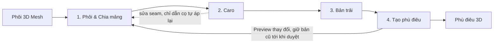
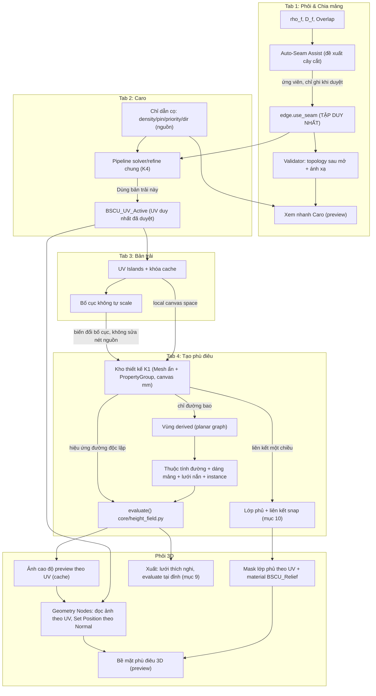

# ĐẶC TẢ THIẾT KẾ GIAO DIỆN & TRẢI NGHIỆM NGƯỜI DÙNG (UI/UX SPECIFICATION)
**Dự án:** Hệ thống Điêu khắc CNC 2.5D Tham số hóa trên Blender (BSCU)  
**Tài liệu:** UI/UX 4 bước: Phôi & Chia mảng → Caro → Bản trải → Tạo phù điêu
**Phiên bản:** 1.7.0 | **Trạng thái:** Đã chốt toàn bộ UI/UX 4 bước (seam đưa lên đầu, Caro là tab riêng với cọ chỉ dẫn), máy 5 trục, độ phân giải hai tầng, xuất xưởng, lớp phủ màu, mẫu/instance, nhập SVG/DXF và kiến trúc kỹ thuật (mục 9–12). **UX-0 đã triển khai và kiểm chứng** (xem cột Trạng thái ở mục 8); UX-1 trở đi chưa code. Solver, hiệu năng và độ chính xác xuất vẫn chưa kiểm chứng.

---

## 1. TỔNG QUAN KIẾN TRÚC UI/UX & LUỒNG CÔNG VIỆC TỔNG THỂ

Hệ thống BSCU hỗ trợ tạo phù điêu tham số trên phôi cong, giữ vector nguồn và kiểm soát sai lệch khi chiếu 3D. Bề mặt cong hai chiều không thể trải phẳng bảo toàn mọi khoảng cách; không cam kết tuyệt đối không méo.

Quy trình trải nghiệm người dùng tuân theo luồng tuyến tính 4 Tab (nhưng hỗ trợ đồng bộ dữ liệu hai chiều - Bi-directional Synchronization):



**Vì sao seam đi trước Caro:** Caro cần bản trải, bản trải cần seam. Chốt seam trước thì công nắn Caro không bị phá; chỉ dẫn cọ (mục 3B.3) vẫn bảo vệ trường hợp quay lại sửa seam.

### Nguyên tắc UX Xuyên suốt (Core UX Principles)
1. **Phản hồi phân tầng:** thao tác phản hồi ngay; phân biệt preview và kết quả đã kiểm tra, không dùng số liệu cũ như kết quả mới.
2. **Phi phá hủy:** giữ nét nguồn và cấu hình; đổi UV/seam khi đã có hoa văn phải preview ảnh hưởng trước khi thay bản đang dùng (mục 6).
3. **Mô hình Trực quan Hóa (Visual Indicators):** Mọi biến dạng (Distortion), lỗi chồng lấn (Overlap), hoặc sai lệch diện tích đều có bản đồ nhiệt màu (Color Heatmap) cảnh báo trực quan cho người dùng.

### Điều hướng dành cho người mới

- Bốn bước hiển thị: **Phôi & Chia mảng → Caro → Bản trải → Tạo phù điêu**. Mục 2 (phôi) và mục 3 (chia mảng) cùng thuộc Tab 1; mục 3B là Tab 2; mục 4 là Tab 3; mục 5 là Tab 4.
- Luồng có hướng dẫn, được quay lại; thuật toán nằm trong phần nâng cao. Bắt đầu bằng **Dùng làm phôi**, xác nhận kích thước mm, chọn vùng trang trí rồi **Đề xuất cách chia**.
- **Kiểm tra & Xuất** là hành động cuối (mục 9). Máy đích là CNC 5 trục; BSCU không mô phỏng CAM, không kết luận an toàn gia công chỉ từ UV/manifold.

### 1.1. Nền tảng Canvas 2D Dùng Chung (Shared 2D Canvas Foundation)

**Vì sao không dùng UV Editor / Image Editor của Blender:**
UV trong Blender gắn cứng vào loop của mesh — người dùng **không tạo được** đoạn thẳng, cung tròn hay đường cong mới bên trong UV Editor. Nhưng Tab 4 đòi Line / Arc 3-point / Spline / Fillet / Chamfer / Trim / Extend cùng Smart-Snap HUD. Blender cũng không có widget canvas 2D để nhúng. Đây là **ràng buộc API cứng**, không phải lựa chọn tuỳ ý.

**Quyết định:** một canvas 2D duy nhất, tự vẽ bằng GPU draw handler trong 3D Viewport, dùng chung cho Tab 1 (xem mảng), Tab 3 và Tab 4.

| Đặc điểm | Chốt |
| :--- | :--- |
| Nơi vẽ | 3D Viewport, nhìn thẳng (orthographic) xuống mặt phẳng quy ước $z = 0$; mọi hình học 2D nằm trên mặt phẳng này |
| Đơn vị | Hiển thị mm, quy đổi theo `scene.unit_settings.scale_length`; không coi chọn Metric/mm là đủ để 1 Blender unit = 1 mm, không tự rescale scene |
| Hit-test | Ray từ con trỏ xuống mặt phẳng $z=0$ — không phụ thuộc hình học 3D của phôi |
| Bắt điểm | Một bộ snap dùng chung: Endpoint, Midpoint, On-Curve, Intersection, cùng lưới và trục đã bật |
| Lớp nội dung | Tab = lớp được bật/tắt: Tab 1 = mảng ứng viên, Tab 3 = bố cục đã trải, Tab 4 = nét vẽ + vùng + lưới dốc |
| Image Editor (UV) | Cửa sổ xem phụ **tuỳ chọn**, không phải nguồn sự thật, không dùng làm canvas vẽ |

**Ràng buộc hiệu năng:** chỉ dựng lại buffer hình học khi *input* thay đổi (kéo dot, đổi tham số, kết thúc thao tác), **không** dựng lại mỗi frame vô điều kiện; phần vẽ phải gom batch theo màu/trạng thái để giữ ≥ 60 fps.

**Hệ quả bắt buộc:** mọi công cụ bán trong Tab 4 là **modal operator tự viết** đi qua một lớp trừu tượng canvas duy nhất (`draw/canvas_2d.py`) — không dựa vào chế độ vẽ có sẵn nào của Blender.

---

## 2. TAB 1 (PHẦN A): PHÔI VÀ VÙNG TRANG TRÍ

### 2.1. Mục tiêu và luồng chính

Người dùng xác nhận **đúng phôi, đúng kích thước, đúng vùng trang trí** trước khi thiết kế. Không yêu cầu biết UV hoặc chọn thuật toán.

**Chọn phôi → Xác nhận kích thước → Chọn vùng trang trí → Đề xuất cách chia (mục 3) → Dùng cách chia này → sang Tab 2 Caro.**

- Chưa có phôi: hiện **Chọn vật thể Mesh → Dùng làm phôi**, không hiện bảng solver trống.
- Hiển thị kích thước world-space đã quy đổi mm theo scene. Xác nhận là ghi nhận đơn vị/kích thước đang dùng, không tự scale hoặc apply transform.
- Vùng trang trí: toàn phôi hoặc tập mặt được chọn; có thêm/bớt vùng và highlight. Mặc định chọn mặt nhìn thấy, không xuyên qua mặt sau; chọn xuyên là tùy chọn tường minh.
- Chỉ phân tích vùng có liên quan và vùng lân cận cần thiết, không ép unwrap đáy/mặt sau không trang trí.
- UV sẵn có của người dùng không bị ghi đè; BSCU luôn ghi vào `BSCU_UV_Active` riêng. Có thể dùng UV sẵn có làm điểm khởi đầu cho bản trải ở Tab 2.

### 2.2. Nội dung giao diện và phản hồi

| Nhóm mặc định | Nội dung |
| :--- | :--- |
| Phôi | Tên, kích thước mm, Đổi phôi |
| Vùng trang trí | Toàn phôi/Vùng chọn, Chọn vùng, Xem vùng |
| Kiểm tra bề mặt | Lỗi/cảnh báo cụ thể, Đến vị trí, hành động khắc phục |
| Hành động chính | Đề xuất cách chia; sau đó sửa seam (mục 3) và Dùng cách chia này |

- **Hiển thị sai lệch** (dùng ở mục 3 và 3B) có thang đo, chú giải và giá trị khi chọn; không chỉ phân biệt bằng màu. Nút **Đến vùng sai lệch lớn** thay cho nhấp nháy liên tục.
- Chuyển tab không tự sửa mesh, tự chạy lại tác vụ nặng hoặc thay bố cục.
- Trong khi tính: hiện giai đoạn và Hủy; nếu không biết phần trăm thì không dựng tiến độ giả. Kết quả cũ mang nhãn **Chưa cập nhật**; kết quả preview không được ghi là đã kiểm tra.

### 2.3. Chỉ số đo và ý nghĩa

- Đo trên bề mặt evaluated dùng làm nền thiết kế, trước displacement của BSCU để tránh phản hồi vòng. Dữ liệu UV/cage phải có quan hệ hỗ trợ được; không suy đoán correspondence qua modifier thay topology.
- Tọa độ 3D tính theo mm world-space. Trên tam giác không suy biến, Jacobian từ cơ sở tiếp tuyến trực chuẩn sang UV có singular values $\sigma_1 \ge \sigma_2 > 0$.
- $\rho_f=\sqrt{A_{uv,f}/A_{3d,f}}$ (UV/mm); $\rho^*=\operatorname{median}(\rho_f)$ là mốc mật độ tương đối, không phải chứng nhận kích thước tuyệt đối.
- $\delta_f=\rho_f/\rho^*-1$ đo mật độ tương đối; $s_f=\sigma_2/\sigma_1$ đo bất đẳng hướng, không riêng shear. $D_f=\sqrt{\delta_f^2+(1-s_f)^2}$ là điểm tổng hợp **không được gọi là phần trăm sai số chiều dài**.
- RMS của $D_f$ dùng trọng số diện tích 3D; kèm cực đại và vùng phân bố, không chỉ một số trung bình. Chiều dài/hướng giãn cục bộ đo riêng từ ánh xạ đã quy đổi metric.
- Mặt suy biến, lật UV và tự chồng lấn được kiểm riêng; median mật độ không phát hiện được lỗi scale đồng đều toàn bộ bản trải.
- Mục tiêu RMS 3% hoặc cảnh báo 15% trong thiết kế cũ không phải ngưỡng đúng cho mọi hình. Hiển thị chỉ số theo đúng định nghĩa, ngưỡng phải gắn với metric và bộ ca đã hiệu chuẩn trước nghiệm thu.

### 2.4. Chuẩn bị tự động và kiểm tra đầu vào

- Một pipeline dùng chung tạo đề xuất seam, bản trải ứng viên và metric cho cả Tab 1–3; không tab nào có solver độc lập.
- Phân biệt **lỗi chặn**, **cảnh báo chất lượng** và **điều kiện đầu ra**. Mesh hở có thể là nền thiết kế hợp lệ; không đồng nhất với lỗi không kín của sản phẩm xuất.
- Mặt suy biến, topology không được hỗ trợ hoặc không xác định được vùng chiếu phải báo vị trí và nguyên nhân. Không tự vá lỗ, apply modifier, remesh hoặc thay kích thước.
- Auto-Seam ưu tiên ít đường chia và sai lệch thấp; phương án là đề xuất, không lời hứa đạt distortion cố định trên sphere/torus/saddle bất kỳ. Dijkstra trên cạnh là công cụ tìm đường, không tự chứng minh topology đã mở hợp lệ.
- Seam hợp lệ thì cho sang Tab 2 ngay. Không ép thao tác công cụ seam để hoàn thành một checklist.

### 2.5. Ranh giới trách nhiệm ba tab đầu

| Tab | Trách nhiệm | Không làm |
| :--- | :--- | :--- |
| 1. Phôi & Chia mảng | Xác nhận đầu vào, vùng trang trí, đề xuất/sửa seam | Không âm thầm sửa phôi; không tạo đường khắc hay cắt mesh vật lý |
| 2. Caro | Trải phẳng, đo méo, nắn bằng chỉ dẫn cọ, duyệt ánh xạ | Không đổi seam; không xếp bố cục |
| 3. Bản trải | Đặt tên, xoay, xếp bố cục, đo sau chiếu | Không đổi ánh xạ trong mảng |

Nguồn đã chấp nhận: tập seam trên mesh, chỉ dẫn cọ (mục 3B.3) và `BSCU_UV_Active`. Ứng viên/preview là dữ liệu dẫn xuất tạm, không là nguồn thiết kế thứ hai. Khi đã có hoa văn, quy tắc duyệt thay đổi tại mục 6 áp dụng cho cả ba tab.

### 2.6. Trách nhiệm triển khai

- Toán metric/seam nằm trong `core/`, không import `bpy` hoặc `mathutils`; cầu nối quản lý đọc/ghi Blender, hàng đợi, context và overlay.
- Solver chốt tại K4 (mục 11).

### 2.7. Tiêu chí nghiệm thu phần phôi (Tab 1)

- Ca chưa chọn phôi, có UV sẵn, đơn vị khác nhau và scale không đồng nhất đều hiển thị kích thước/trạng thái đúng; không tự đổi phôi.
- Chọn mặt mặc định không xuyên sang mặt sau; vùng chọn được lưu và khôi phục.
- Phân biệt mặt hở được hỗ trợ với lỗi ánh xạ chặn; mọi lỗi có vị trí hoặc nguyên nhân cụ thể.
- Kiểm metric bằng ca đồng nhất, giãn một trục, scale đồng đều, mặt lật và suy biến; không mặc định giãn U hai lần đồng nghĩa $D_f=100\%$.
- Hủy không đổi bản đã duyệt; kết quả quá hạn không ghi vào phôi khác. Vật liệu, UV gốc và modifier không bị thay đổi ngoài giao dịch đã xác nhận.
- Mục tiêu đo trên bộ ca/máy công bố: phản hồi UI liên tục; đề xuất cách chia 200k tam giác hướng tới dưới 3 giây. Không coi đây là số đo đã đạt.

### 2.8. Quyết định vận hành D1–D4

**D1 — Pipeline chung, revision và ranh giới Blender.**
- Mọi truy cập `bpy` trên main thread. Tác vụ core nhận snapshot thuần, không nhận đối tượng Blender; cơ chế worker phải kiểm chứng vòng đời/an toàn trên Blender đích, không coi “numpy thuần” là đủ bảo đảm mọi mô hình threading.
- Mỗi job gắn revision phôi, topology, vùng, seam, ánh xạ, tham số; chỉ áp kết quả còn khớp. Hủy/Undo/đổi phôi vô hiệu hóa kết quả cũ.
- API unwrap của Blender dù chạy C vẫn được gọi đúng main-thread/context; phải đo khả năng chặn UI, không tuyên bố tự nhiên thành tác vụ nền. Nếu không đáp ứng, chọn solver trên snapshot hoặc phương án tiến trình cách ly trước nghiệm thu.

**D2 — Overlay tạm, khôi phục đúng trạng thái.**
- Chỉ bật khi có dữ liệu hợp lệ. Không giả định thêm một material slot sẽ tự thay hiển thị mọi mặt.
- Cơ chế overlay phải giữ nguyên material slot/link/index và trạng thái shading có trước; khôi phục khi tắt overlay, rời ngữ cảnh, đổi mode, lưu file và unregister. Không ép slot OBJECT của người dùng về DATA.

**D3 — Cọ sửa cage được hỗ trợ, đo trên nền evaluated.**
- Hit-test phải xác định đúng cage và mặt được sửa. Cờ On Cage không được coi là bằng chứng raycast evaluated trả index cage.
- Nếu không có ánh xạ/cage dùng được, khóa cọ kèm lý do; không ẩn modifier âm thầm. Mọi chế độ xem tạm có nhãn và khôi phục trạng thái cũ.
- Trong kéo dùng preview cục bộ; sau thao tác đo lại evaluated và đánh dấu trạng thái kiểm tra.

**D4 — Điều hướng và phôi ổn định.**
- N-panel BSCU là điểm vào bốn bước; không tái chia area khi chuyển tab (D12).
- Tham số/vùng thuộc bộ thiết kế của phôi. Chọn Curve không đổi phôi đang làm. Tab có thể lưu theo scene, không hứa giữ nguyên khi mở một file khác có scene khác.

---

## 3. TAB 1 (PHẦN B): CHIA MẢNG

### 3.1. Mục tiêu và luồng

**Xem đề xuất → chỉnh nếu cần (xem nhanh Caro) → Dùng cách chia này → sang Tab 2 Caro.** Seam chỉ mở ánh xạ, không tạo rãnh hoặc cắt mesh vật lý. Giao diện ghi rõ sự khác biệt này.

- **Xem nhanh Caro:** công tắc trong phần chia mảng. Mỗi lần đổi seam, trải nhanh bằng core (LSCM, áp các chỉ dẫn cọ đã có) và phủ Caro/bản đồ nhiệt nhãn *Xem trước* để đánh giá đường cắt ngay. Không ghi `BSCU_UV_Active`.

- 3D hiển thị đường chia; canvas dùng chung hiển thị mảng ứng viên. Nếu cách chia hiện tại đủ dùng, cho đi tiếp không bắt thêm đường.
- Đề xuất và seam đã duyệt có kiểu nét/nhãn khác nhau, không chỉ khác màu. Một hành động dùng đề xuất là một giao dịch Undo.
- Enter xác nhận đường ứng viên, Esc hủy thao tác đang làm; không chiếm Space để tránh xung đột phát animation. Sau chỉnh, **Dùng cách chia này** xác nhận cả bản ứng viên.

### 3.2. Bốn công cụ được giữ, phân tầng giao diện

| Mức | Công cụ | Hành vi |
| :--- | :--- | :--- |
| Chính | Đường chia qua điểm | Chọn các điểm trên bề mặt, tìm chuỗi cạnh giữa chúng; preview đúng chuỗi sẽ áp |
| Chính | Biên vùng chọn | Lấy cạnh có đúng một mặt thuộc tập chọn, gồm cả biên mesh khi phù hợp; không nhầm với `edge.is_boundary` toàn mesh |
| Hỗ trợ | Chia gần mặt phẳng tham chiếu | Gizmo mặt phẳng gợi ý đường gần nó trên cạnh có sẵn, không hứa giao tuyến chính xác |
| Hỗ trợ | Viền theo hướng nhìn | Đề xuất cạnh contour rồi kiểm tra hiển thị, liên tục và topology |

- Chọn điểm không tự xuyên qua mặt sau; công cụ xóa seam có preview. Đường ngắn nhất trên đồ thị cạnh không được gọi là geodesic chính xác trên bề mặt liên tục.
- Tích dấu normal với hướng nhìn chỉ tạo tập contour ứng viên, không đủ lọc phần bị che khuất hay đảm bảo viền ngoài đúng trong hốc lõm.
- Mặt phẳng tham chiếu hiển thị độ lệch đường thực tế với mặt phẳng; nếu lưới quá thô, báo giới hạn. Không tự subdivide/bisect để làm preview đẹp hơn.

### 3.3. Validator và phục hồi

- Kiểm tra topology **sau mở seam**, có tính các bản sao đỉnh/cạnh trên biên cắt; không chỉ lấy $V-E+F$ từ tập mặt nguyên gốc.
- Dạng đĩa cần thành phần liên thông, manifold phù hợp, orientable, một vòng biên và Euler phù hợp. $\chi=1$ riêng lẻ không đủ chứng minh trên mesh lỗi.
- Đầu seam bậc 1 là vị trí cần phân tích, **không mặc định lỗi**. Đường mở một mặt kín có thể có đầu mút hợp lệ; không ép số đầu cụt bằng 0.
- Đỉnh cong lớn không nằm trên seam không tự là lỗi topology. Đánh giá bản trải, độ méo và khả năng solver hỗ trợ.
- Phát hiện mặt lật, suy biến và giao phần trong tam giác UV; cạnh/đỉnh chung hợp lệ không tính thành overlap.
- Cảnh báo luôn kèm **Đến vị trí**, lý do và đề xuất nối/đổi đường; không tự nối seam hoặc yêu cầu đóng mọi đường thành vòng.

### 3.4. Preview và cache dùng chung

- Hai tầng: preview nhẹ khi thao tác và kiểm tra đầy đủ khi hoàn tất. Mục tiêu preview khoảng 10 Hz; nếu chưa xong giữ hình cũ có nhãn, không khóa tương tác và không ghi số cũ thành kết quả mới.
- Tái tính phần bị ảnh hưởng; kiểm overlap giữa phần đổi và phần giữ lại, không chỉ trong island vừa đổi. Packing cần kiểm tra toàn bộ bố cục cuối.
- Khóa cache gồm revision hình học/topology/transform/vùng/seam/UV và tham số solver; **không chỉ hash tập seam** vì mặt có thể đổi hình mà seam không đổi.
- Quy tắc job, hủy và áp kết quả tại D1. Đổi nhanh liên tiếp chỉ áp revision mới nhất phù hợp.

### 3.5. Hiển thị và hỗ trợ

- Đường đủ dày theo pixel; phần khuất có chế độ hiển thị riêng, không giả đường xuyên mặt là ở mặt trước.
- **Ẩn mảng / Hiện tất cả** chỉ phục vụ quan sát, không xóa khỏi vùng thiết kế. Hủy công cụ khôi phục trạng thái tạm.
- Giữ góc nhìn khi chọn mảng; **Đến mảng** là hành động riêng, không tự zoom làm người dùng mất vị trí mỗi click.

### 3.6. Trách nhiệm triển khai

`core/uv_islands.py`, `core/seam_graph.py`, bộ kiểm metric và bộ solver chung xử lý dữ liệu thuần; operator chuyên biệt cho từng công cụ; overlay/canvas chỉ hiển thị dữ liệu. Xem nhanh Caro dùng chung solver với Tab 2, không có pipeline unwrap thứ hai.

### 3.7. Tiêu chí nghiệm thu phần chia mảng (Tab 1)

- Giữ đủ bốn công cụ; preview chuỗi cạnh đúng kết quả áp, mesh topology không đổi.
- Bộ ca gồm mặt đĩa, mặt có lỗ, sphere mở, torus, mesh lỗi và seam có đầu mút hợp lệ; không báo lỗi chỉ vì bậc đỉnh bằng 1.
- Hủy/Undo khôi phục cả seam và ánh xạ liên quan; chỉnh sau khi có hoa văn tuân thủ giao dịch mục 6.
- Thay hình học nhưng giữ seam làm cache hết hạn; đổi một island vẫn phát hiện overlap với island chưa đổi.
- Mục tiêu trên bộ ca 200k tam giác công bố: preview 10 Hz, kết quả chuẩn hướng tới 2 giây. Quá thời gian phải còn thao tác/hủy được; kiểm chứng trên UI thật.

### 3.8. Quyết định vận hành D5–D7

**D5:** chia gần mặt phẳng trên cạnh có sẵn, không cắt topology; độ lệch được báo, không gọi là Bisect chính xác.

**D6:** hiển thị mảng ứng viên dùng canvas mục 1.1; không tự bố trí lại area khi chuyển tab.

**D7:** cache chỉ là dữ liệu RAM dẫn xuất, khóa theo mục 3.4. Nhận diện mảng dựa vào tập mặt nguồn khi topology còn tương ứng; topology đổi không rõ ánh xạ phải yêu cầu xử lý, không coi face index là ID bền vững tuyệt đối.

---

## 3B. TAB 2: CARO — TRẢI PHẲNG VÀ NẮN CHỐNG MÉO

### 3B.1. Mục đích

Tab Caro là "tấm vé bảo hiểm chống méo": ô Caro vuông là thước đo mắt thường cho người thợ. Ô méo thành chữ nhật = lệch tỉ lệ; ô vặn xiên = méo góc; ô to nhỏ khác nhau = mật độ không đều. Khi Caro trên phôi vuông và đều nhất có thể, hoa văn vẽ ở Tab 4 chiếu lên 3D giữ hình và tỉ lệ gần nhất với bản vẽ. Mặt cong hai chiều không trải phẳng tuyệt đối được; mục tiêu là đưa méo về mức chấp nhận được và đặt phần méo còn lại ở nơi ít ảnh hưởng.

**Luồng:** **Trải phẳng (tự động) → Xem Caro / bản đồ nhiệt → Dàn đều → Nắn vùng khó bằng cọ → Dùng bản trải này → sang Tab 3.**

### 3B.2. Hiển thị

- Vào tab: gán vật liệu Caro lên toàn mô hình theo `BSCU_UV_Active` (hoặc ứng viên đang xem, có nhãn *Xem trước*). Vật liệu, slot và shading gốc được giữ và trả lại khi rời tab hoặc tắt Caro (D2).
- **Kích thước ô danh nghĩa theo mm** (thanh trượt, vd 2/5/10/20/50 mm) + **thước đo mm** hiển thị trên viewport; phôi lớn dùng ô to để xem tổng quan, vùng chi tiết thu ô nhỏ. Kích thước ô là danh nghĩa theo quy đổi, không hứa mọi ô trên phôi đúng kích thước đó.
- Công tắc **Caro ↔ Bản đồ nhiệt méo** (mục 2.3): xanh lá = gần 1:1, đỏ = giãn, xanh dương = co; có thang đo, chú giải, giá trị khi trỏ; **Đến vùng sai lệch lớn**.

### 3B.3. Chỉ dẫn cọ là nguồn, UV là dẫn xuất

- Cọ **không sửa UV trực tiếp**. Cọ ghi **chỉ dẫn** lên mặt phôi (face attribute): `bscu_density` (hệ số mật độ mong muốn, mặc định 1), `bscu_pin` (ghim), `bscu_priority` (0 = giữ kích thước … 1 = giữ hình), `bscu_dir` (hướng U mong muốn, vector tiếp tuyến).
- Mỗi lần trải (Tab 2, xem nhanh ở Tab 1, hoặc sau khi quay lại sửa seam), solver đọc lại chỉ dẫn ⇒ ý đồ nắn tự áp lại, không mất công. Chỉ dẫn thuộc bộ thiết kế của phôi, lưu trong `.blend`, Undo chuẩn.
- Mảng vừa đổi seam: chỉ dẫn vẫn nằm trên mặt nên áp được; vùng ghim bị seam cắt qua được báo để người dùng xem lại.

### 3B.4. Dàn đều tự động

- Nút **Dàn đều Caro**: solver core (K4) tối thiểu năng lượng cân bằng giữa **giữ hình** (góc, conformal) và **giữ kích thước** (diện tích/chiều dài), kiểu ARAP, có trọng số theo chỉ dẫn.
- Thanh trượt toàn cục **Giữ hình ↔ Giữ kích thước** (mặc định cân bằng); cọ Tô ưu tiên ghi đè theo vùng.
- Có giới hạn vòng lặp/thời gian và Hủy. Kết quả không được làm tăng lật/suy biến/overlap; nếu tăng thì giữ ứng viên hợp lệ trước đó và báo **Cần sửa**.

### 3B.5. Bộ 5 cọ trên bề mặt 3D

| Cọ | Chỉ dẫn ghi | Tác dụng |
| :--- | :--- | :--- |
| Nở / Co | `bscu_density` (Ctrl = Co) | Ô Caro vùng tô to lên / nhỏ lại |
| Thư giãn | Làm mượt chỉ dẫn đã tô, trả dần về mặc định | Xóa vết nắn gắt, làm đều cục bộ |
| Ghim | `bscu_pin` | Giữ hình dạng/vị trí tương đối vùng khi trải lại |
| Tô ưu tiên | `bscu_priority` | Vùng chữ/hoa tròn giữ hình; vùng rãnh dài giữ kích thước |
| Chỉ hướng Caro | `bscu_dir` (vẽ nét trên bề mặt) | Định hướng U cục bộ, vd theo thớ gỗ, chiều dài chân ghế |

- Phím chung: F cỡ cọ, Shift+F lực, Shift giữ = Thư giãn tạm. Cỡ cọ theo pixel màn hình, hiển thị kèm quy đổi mm tại điểm trỏ.
- Chỉ tô mặt nhìn thấy, không xuyên mặt sau; tùy chọn xuyên tường minh. Chỉ tác động trong vùng trang trí.
- **Phản hồi:** trong lúc kéo, solver giải lại cục bộ quanh vết cọ và Caro đổi ngay dưới cọ (~30 fps, nhãn *Xem trước*); thả chuột thì giải lại toàn mảng, đo lại và cập nhật trạng thái. Một nét cọ = một bước Undo.
- Hit-test cọ trên cage theo D3; không có cage dùng được thì khóa cọ kèm lý do.

### 3B.6. Trạng thái và duyệt

- Trạng thái mảng dùng bảng mục 4.5 (Có thể thiết kế / Có cảnh báo / Cần sửa / Chưa kiểm tra / Đang tính).
- **Dùng bản trải này** ghi ứng viên vào `BSCU_UV_Active` sau kiểm tra đầy đủ. Khi đã có hoa văn, áp quy tắc Giữ bản cũ / Dùng bản mới (mục 6).

### 3B.7. Tiêu chí nghiệm thu Tab 2

- Vào/rời tab và tắt Caro trả nguyên vật liệu/slot/shading gốc, kể cả sau lưu/mở file.
- Ca biết trước: tô Nở ×2 trên một vùng mặt phẳng làm mật độ UV vùng đó tăng ~2 lần so với vùng không tô (trong dung sai công bố); Ghim giữ UV vùng ghim khi trải lại; Chỉ hướng xoay U cục bộ theo nét.
- Sửa seam ở Tab 1 rồi trải lại: chỉ dẫn áp lại, các vùng đã nắn giữ ý đồ (so metric trước/sau trên vùng không bị seam cắt).
- Dàn đều không tăng lật/suy biến/overlap; hủy giữa chừng không đổi bản đã duyệt.
- Mục tiêu: cọ phản hồi ≥30 fps trên bộ ca công bố; giải toàn mảng khi thả chuột hướng tới ≤1 giây cho mảng 50k tam giác. Chưa coi là số đã đạt.

---

## 4. TAB 3: BẢN TRẢI

### 4.1. Mục tiêu và luồng

Người dùng biết **vẽ ở mảng nào, hướng nào, sai lệch ở đâu** trước khi tạo phù điêu. Ánh xạ trong mảng đã chốt ở Tab 2; Tab 3 chỉ xếp bố cục.

**Chọn mảng → Đặt tên → Xoay/Bố trí → Đo sau chiếu → Bắt đầu tạo phù điêu.**

### 4.2. Giao diện và chọn đồng bộ

- Canvas 2D và preview 3D đồng thời; danh sách mảng có tên, kích thước bản trải theo mm và trạng thái kiểm tra.
- Chọn 2D highlight mảng 3D và ngược lại, không tự zoom. Nút **Đến mảng** căn khung khi yêu cầu.
- Thao tác chính: di chuyển bố cục, xoay, đặt tên, đo. Không có solver trong tab này.
- Không có UV hợp lệ thì hiện hành động quay về Tab 2 (Caro) hoặc Tab 1 (chia mảng), không mở canvas trống không giải thích.

### 4.3. Xếp bố cục khác với trải lại

| Hành động | Tab | Tác động | An toàn với thiết kế |
| :--- | :--- | :--- | :--- |
| Xếp lại bố cục | 3 | Xoay/tịnh tiến khung island | Không đổi hình chiếu hoa văn trên phôi |
| Trải lại bề mặt | 2 | Thay ánh xạ trong island | Có thể đổi hình chiếu; preview trước khi áp nếu đã có hoa văn |

- Một pipeline chung unwrap/refine/metric phục vụ Tab 1–2. Không gộp hai hành động thành nút Tối ưu không rõ nghĩa.
- Mọi lệnh bpy tuân D1. Đo lại kết quả sau mọi bước làm thay đổi ánh xạ hoặc bố cục.

### 4.4. Kích thước, metric và packing

- Tách **kích thước thiết kế trên canvas** và **kích thước sau chiếu**. Chuẩn hóa mật độ giữa các mảng không tạo phép trải đẳng cự cho mặt cong.
- Packing chỉ xoay/tịnh tiến; không tự scale mảng để vừa khổ. Hiệu chuẩn metric thuộc bản trải ở Tab 2, không thay đổi ngầm khi xếp lại.
- Khoảng cách giữa mảng tính bằng mm canvas, không gọi là khoảng hở dao trên sản phẩm. Khổ canvas tùy chọn chỉ là giới hạn bố cục, không là kích thước bàn máy mặc định.
- Xoay bản trải để dễ vẽ không tự thay hướng thớ vật liệu hoặc hướng chạy dao. Muốn đổi hướng hoa văn trên phôi là thao tác thiết kế riêng.
- Công cụ đo đường sau chiếu tính chiều dài dọc bề mặt từ ánh xạ, không lấy khoảng cách dây cung hai đầu. Hiển thị cả số 2D, số 3D và sai lệch; đánh dấu phép đo không xác định khi đường đi qua phần ánh xạ lỗi.

### 4.5. Trạng thái kiểm tra và đồng bộ (dùng chung Tab 2–3)

| Trạng thái | Ý nghĩa | Hành động |
| :--- | :--- | :--- |
| Có thể thiết kế | Ánh xạ hợp lệ, kiểm tra cập nhật | Cho sang Tab 4 |
| Có cảnh báo | Ánh xạ dùng được nhưng còn sai lệch đáng chú ý | Cho tiếp tục kèm vị trí/lý do cảnh báo |
| Cần sửa | Ánh xạ mơ hồ, mặt lật/suy biến/overlap trong miền chiếu | Chặn dùng bản ứng viên lỗi, chỉ đường sửa |

- Chưa kiểm tra/đang tính là trạng thái riêng, không hiển thị Có thể thiết kế. Bản hợp lệ cũ vẫn có thể được giữ khi bỏ ứng viên lỗi.
- Trạng thái chỉ nói về bản trải, không chứng nhận an toàn gia công. Khổ vượt chỉ cảnh báo bố cục, không tự trở thành lỗi hình học.
- Cache/identity theo D7; quy tắc giữ hoa văn, preview và xác nhận theo mục 6. Chuyển tab không tự áp ứng viên.

### 4.6. Trách nhiệm triển khai

Cầu nối `uv_bridge` quản lý context và áp ứng viên (Tab 2) và bố cục (Tab 3); solver/refine/metric dùng chung; dữ liệu bố cục tách khỏi tọa độ thiết kế local. Lựa chọn song hướng canvas/3D đọc cùng ánh xạ island–mặt nguồn, không lưu hai bản selection thiết kế độc lập.

### 4.7. Tiêu chí nghiệm thu Tab 3

- Xếp lại/xoay mảng không đổi điểm chiếu và kích thước hoa văn trên phôi trong dung sai số công bố; đổi khổ không tự scale.
- Đổi bố cục sau khi có hoa văn không đổi hình chiếu; hủy/Undo khôi phục nhất quán bố cục và liên kết.
- Ca mặt phẳng và mặt cong biết trước xác minh đo dọc bề mặt khác dây cung; RMS thấp không che lỗi cục bộ.
- Ba trạng thái tại mục 4.5 cùng trạng thái đang tính/chưa kiểm tra xuất hiện đúng; không cho dùng ứng viên có overlap/lật tại miền chiếu.
- Chọn hai chiều, Đến mảng và mở lại file được kiểm trên Blender thật.

### 4.8. Quyết định vận hành D8–D9

**D8 — Chuẩn hóa và đo trên kết quả cuối.** Chuẩn hóa mật độ metric là bước của bản trải ở Tab 2; có thể dùng `average_islands_scale()` nếu đáp ứng hợp đồng. Đo lại sau refine/chuẩn hóa/packing; không coi tên một API là bằng chứng tỷ lệ đúng. Không tự chạy bước rescale này khi chỉ xếp lại bố cục ở Tab 3.

**D9 — Khổ canvas không tự thu nhỏ.** Vượt khổ thì báo kích thước thực tế và cho xếp lại/đổi khổ. Giữ kích thước thiết kế, không hứa kích thước 2D bằng mọi khoảng cách trên phôi cong.

---

## 5. TAB 4: TẠO PHÙ ĐIÊU — ĐƯỜNG, MẢNG VÀ LƯỚI NẮN KHỐI

### 5.1. Luồng sử dụng và bố cục

Luồng chính: **Vẽ nét → tạo rãnh/gờ trực tiếp hoặc dùng làm biên mảng → tạo dáng mảng → thêm đường điều khiển → nắn qua nút giao và biểu đồ bên phải.**

- Canvas 2D là nơi vẽ/chọn; khung xem trước 3D luôn có thể quan sát đồng thời (người dùng tự chia viewport, D12).
- N-Panel BSCU (gọi tắt **Inspector**, U2 mục 12) chứa danh sách lớp, thuộc tính và biểu đồ; nội dung ẩn/hiện theo công cụ và đối tượng đang chọn.
- Chọn mảng mặc định chỉ hiện Nổi/Lõm, Chiều cao/Độ sâu, Dáng khối và Chuyển tiếp ở mép. Biểu đồ nâng cao mở qua **Sửa dáng khối**; lưới chỉ hiện khi bật **Nắn khối**.
- Không tự chia lại màn hình mỗi lần chuyển bước. Tôn trọng bố cục người dùng đã chỉnh.
- Quyết định bố trí biểu đồ nằm tại D11–D12, mục 5.10; không dùng HUD nổi che bản vẽ.

### 5.2. Đối tượng, vai trò đường và lớp tổ chức

| Vai trò | Tác dụng | Quy tắc |
| :--- | :--- | :--- |
| Đường tạo hình | Tạo rãnh hoặc gờ, rộng/hẹp và sâu/cao biến thiên dọc đường | Hiệu ứng phải được bật chủ động |
| Đường bao | Giới hạn mảng kín cùng những đường khác | Có thể đồng thời mang hiệu ứng tạo hình |
| Đường điều khiển mảng | Nắn cao độ và độ dốc của mảng | Không tự tạo rãnh, không tự chia mảng |

- Muốn dùng đường điều khiển để chia vùng phải chọn **Dùng làm đường chia mảng**; các ô của lưới nắn không tự thành vùng tạo khối.
- Layer chứa hệ đường/mảng riêng; folder gom các layer và folder con thành một hệ tạo hình. Quy tắc nền và thứ tự tính nằm tại mục 5.11.
- Nhóm/lớp hỗ trợ ẩn hướng dẫn, khóa, thêm và đổi thứ tự; thứ tự đánh giá được lưu tường minh, không suy ra từ thứ tự Collection của Blender.
- Lớp phủ màu/vật liệu không thay đổi cao độ, đặc tả tại mục 10. Ẩn hướng dẫn, xem riêng và tắt hiệu ứng là các hành động khác nhau (mục 5.11).

### 5.3. Canvas, chọn và công cụ vẽ

- Pan bằng MMB; zoom tại con trỏ bằng wheel. Click gần biên chọn đường, click trong vùng chọn mảng; khoảng bắt chọn theo pixel màn hình.
- Chỉ hiện điểm neo khi **Sửa nét**, chỉ hiện nút nắn khi **Nắn khối**. Đối tượng chồng nhau chọn qua menu **Chọn đối tượng tại đây**, có highlight xem trước.
- Snap dùng chung: Endpoint, Midpoint, On-Curve, Intersection, lưới và trục. Ký hiệu và nhãn phân biệt được, không chỉ dựa vào màu.
- Công cụ chính: chọn/di chuyển/xoay/đổi kích thước; đường liên tục, Bezier, chữ nhật, tròn/elip; sửa điểm, nối đầu nét, Trim, Fillet; tạo nổi/lõm và khắc theo nét.
- Arc ba điểm, Chamfer và Extend nằm trong nhóm mở rộng, không loại khỏi phạm vi.
- Nhập chiều dài, góc, bán kính có đơn vị; giá trị đã nhập được khóa và biểu thị rõ.
- Một lần kéo hoặc một đoạn vẽ đã xác nhận là một bước Undo. Với đường liên tục, Enter kết thúc; Esc bỏ đoạn preview và thoát, giữ các đoạn đã xác nhận. Với thao tác chỉnh chưa xác nhận, Esc khôi phục trạng thái trước thao tác.
- Trong canvas nhìn từ trên xuống, di chuyển XY và nâng/hạ phải là hai thao tác phân biệt; chỉnh cao độ qua công cụ chuyên dụng, biểu đồ hoặc ô số.

### 5.4. Inspector và biểu đồ theo lựa chọn

| Đối tượng chọn | Thuộc tính và biểu đồ bên phải |
| :--- | :--- |
| Đường tạo hình | Rãnh/Gờ; tiết diện; biểu đồ rộng, sâu/cao và nghiêng dọc đường; chế độ Tự do/Theo dao (mục 5.12) |
| Mảng | Dáng nền Phẳng/Vòm/Chóp/Tùy chỉnh; cao độ; chuyển tiếp biên; cách kết hợp |
| Đường điều khiển mảng | Biểu đồ cao độ dọc đường và điều khiển độ dốc |
| Nút giao | Cao độ chung, độ dốc theo từng hướng đường, chuyển tiếp Mượt/Gãy |

**Biểu đồ dọc đường:** trục ngang là vị trí đầu → cuối; kênh bề rộng và độ sâu/chiều cao có nhãn và đơn vị riêng. Điểm neo hình học có thể mang thuộc tính; được thêm điểm thuộc tính ở vị trí khác dọc đường mà không thêm điểm làm đổi hình học.

**Biểu đồ tiết diện:** hiển thị mặt cắt ngang tại vị trí đang chọn; không đánh đồng với biểu đồ độ sâu dọc đường. Chọn điểm trong biểu đồ hoặc trên canvas đều highlight vị trí tương ứng ở phía còn lại.

- Ràng buộc giữa rộng/sâu/góc và cách thao tác tiết diện được định nghĩa tại mục 5.12.
- Nổi/Lõm dùng số độ lớn dương, chế độ xác định hướng; tách khỏi cách kết hợp hiệu ứng.
- **Cộng trên nền** là mặc định của hệ layer; **Bao ngoài** và **Thay thế** là lựa chọn nâng cao. Quy tắc nền tại mục 5.11 thay thế mặc định Bao ngoài của v1.2.0.
- Rãnh tính độ sâu tương đối từ bề mặt kết quả bên dưới, không từ phôi chưa tạo hình; hệ đo được quy định tại mục 5.12.

### 5.5. Dữ liệu nguồn và lưu trữ

| Thành phần | Nguồn sở hữu |
| :--- | :--- |
| Nét hình học, đường bao, đường điều khiển | Kho thiết kế BSCU (K1, mục 11): Mesh dữ liệu ẩn + PropertyGroup; vai trò và liên kết mảng là metadata. Curve Object chỉ sinh ra để xem/xuất, không là nguồn |
| Vùng nhận diện | Hình học dẫn xuất từ đường bao, liên kết bằng ID nguồn ổn định |
| Hiệu ứng vùng | Dữ liệu bền vững gắn với định danh vùng; không mất khi đường bao tạm hở |
| Điểm thuộc tính dọc đường | Metadata trên đường, tách khỏi điểm neo hình học khi cần |
| Nút giao lưới nắn | Dữ liệu do mảng sở hữu; các đường tham chiếu cùng ID nút, không lưu cao độ trùng lặp |
| Nhóm/lớp và thứ tự hiệu ứng | Cây folder/layer có ID, parent và thứ tự tường minh; Collection tổ chức đối tượng, không là nguồn thứ tự tính ngầm |
| Biểu đồ, highlight, snap | Biểu diễn/thao tác trên dữ liệu nguồn; không là bản sao trạng thái thiết kế |

- Local Canvas Space giữ nét 2D ổn định khi packing chỉ xoay/tịnh tiến island; không bảo đảm giữ mọi khoảng cách trên bề mặt cong khi unwrap thay đổi.
- Lưu/mở `.blend` phải giữ vai trò đường, điểm thuộc tính, hiệu ứng, nút giao chung và liên kết phôi–mảng–hoa văn.

### 5.6. Nhận diện vùng và sửa đường bao

- Khép kín đường chỉ tạo **vùng có thể chọn**, chưa tự sinh khối. Người dùng chọn vùng rồi dùng **Tạo nổi/Tạo lõm**.
- Kéo biên mà vẫn xác định được cùng một vùng: tái tạo vùng dẫn xuất, giữ hiệu ứng và thông số.
- Đường bao hở: tạm ngừng tính hiệu ứng vùng; giữ cấu hình, đánh dấu đầu hở và cung cấp **Đến chỗ hở / Chọn hai đầu nét**. Hình cũ nếu hiển thị phải ghi rõ là kết quả cũ.
- Tách vùng: preview các vùng mới và phương án kế thừa; không nhân đôi hiệu ứng chồng lên nhau một cách âm thầm.
- Nhập vùng có cấu hình khác nhau: yêu cầu chọn cách giữ hiệu ứng, không tự chọn theo thứ tự ngẫu nhiên.
- Không coi `source_edges` là đủ để giải quyết mọi trường hợp tách/nhập; chỉ tự tái sử dụng ID khi xác định tương ứng không mơ hồ.
- Mỗi thay đổi người dùng cùng cập nhật dẫn xuất thuộc một giao dịch Undo; kết quả tính cũ không được ghi đè thao tác mới hoặc Undo.
- Không tự nối khe hở, cắt nét tại biên hay xóa nét ngoài mảng; đưa đề xuất sửa có preview.

### 5.7. Lưới nắn khối và đường điều khiển

- **Lưới nắn khối không phải UV của phôi.** Đây là các đường điều khiển bề mặt bên trong một mảng thiết kế.
- Bật Nắn khối tạo lưới thưa có thể chỉnh hướng/mật độ; có thể tự vẽ một đường dọc và nhiều đường ngang. Không bắt mọi vùng phải có lưới chữ nhật toàn phần.
- Đường điều khiển bị giới hạn bởi miền mảng, không nối xuyên qua lỗ hoặc khoảng ngoài mảng; việc giới hạn tác động không được phá hủy nét nguồn.
- Hai đường điều khiển giao nhau trong cùng mảng dùng chung một nút cao độ. Chỉnh từ đường nào cũng cập nhật nút đó và các đường liên quan.
- Hai đường khắc độc lập giao nhau không tự tạo nút điều khiển chung.
- Nút mặc định có cao độ và Mượt/Gãy; nâng cao có độ dốc theo hướng từng đường đi qua nút. Độ dốc không phải một số vô hướng không xác định phương.
- Nút mặc định lưu mức điều chỉnh so với dáng nền; khóa cao độ tuyệt đối là lựa chọn nâng cao. Đổi chiều cao nền giữ ý đồ nắn tương đối.
- Thứ tự đánh giá: **Dáng nền mảng → Lưới nắn → Rãnh/gờ bám mảng**. Các đường chi tiết đi theo bề mặt sau nắn.
- Nắn mặc định lan mượt cục bộ; hiển thị phạm vi ảnh hưởng theo mm. Không thay cao độ các nút đã cố định để đạt độ mượt; nếu ràng buộc không thỏa phải báo rõ.
- Mặc định giữ biên của dáng nền khi nắn bên trong, không ép biên về cao độ 0. Chọn biên để chủ động sửa cao độ hoặc chuyển tiếp.
- Mảng chung biên không tự hàn: **Nối mượt** cần cùng cao độ và độ dốc tương thích; **Nối có nếp** cùng cao độ nhưng cho phép độ dốc khác. Mảng chồng nhau vẫn là hiệu ứng riêng.
- Nút mặc định Mượt tự động; tay nắm biểu đồ chỉnh dốc, ô số dành cho độ chính xác. Các hướng dốc tại nút mượt phải tương thích với một bề mặt; không âm thầm bỏ qua ràng buộc xung đột.
- Thêm đường/nút lấy giá trị từ bề mặt hiện tại, giữ dáng trong dung sai phải công bố và kiểm chứng trước nghiệm thu. Xóa điều khiển có preview và Undo vì có thể đổi dáng. Ẩn lưới không xóa ràng buộc.
- Thuật toán nội suy và dung sai giữ dáng cần được xác định/đo khi thiết kế solver; các quy tắc UX không được coi là bằng chứng solver đã khả thi.

### 5.8. Ranh giới trách nhiệm triển khai

- `core/planar_graph.py`: nhận diện vùng từ đường bao, không đưa đường điều khiển vào đồ thị chia vùng mặc định.
- `core/profile_curves.py`: kênh thuộc tính dọc đường, tiết diện và nội suy profile.
- `core/height_field.py`: kết hợp dáng nền, nắn và hiệu ứng chi tiết; không import `bpy`.
- `bridge/design_store.py` cùng `properties/`: đọc/ghi kho thiết kế K1 (nét, ID, kênh, nút chung, liên kết); mảng sở hữu nút chung, đường chỉ tham chiếu ID.
- Các operator vẽ, sửa CAD và nắn chỉ xử lý tương tác; canvas và Inspector dùng chung dữ liệu, không tự sở hữu bản thiết kế riêng.
- `nodes/relief_displace.py`: đọc ảnh cao độ preview theo UV, đẩy theo normal (D10). Danh sách module đầy đủ tại K6, mục 11; không xác nhận module đã tồn tại.

### 5.9. Tiêu chí nghiệm thu Tab 4

- Đường dùng độc lập được; một đường vừa làm biên vừa có hiệu ứng chỉ khi bật chủ động.
- Thêm điểm độ sâu không đổi hình dạng đường; các giá trị tại điểm điều khiển và tiết diện tương ứng được kiểm tra bằng ca có kết quả biết trước.
- Vùng kín chưa gán hiệu ứng không làm đổi phôi; sửa biên không mơ hồ giữ cấu hình; tách/nhập/hở tuân theo mục 5.6.
- Hai đường điều khiển chia sẻ đúng cao độ tại nút giao; đường khắc giao nhau không bị liên kết nhầm.
- Biểu đồ ↔ canvas chọn đồng bộ; thay đổi XY không vô tình đổi cao độ.
- Rãnh bám theo bề mặt sau nắn; đổi chiều cao nền giữ điều chỉnh tương đối của nút.
- Undo/Redo và lưu/mở file giữ nguyên liên kết, hiệu ứng và thứ tự đánh giá.
- Layer trên cập nhật khi nền dưới đổi; ca chuẩn nền 4 mm + thân 3 mm = 7 mm, đổi nền thành 6 mm cho kết quả 9 mm, không cộng nền hai lần.
- Gom/bỏ nhóm các layer liên tiếp không có thiết lập nhóm riêng giữ nguyên kết quả; đổi thứ tự, tắt hiệu ứng và Undo tính lại đúng phần phụ thuộc.
- Đường khác layer không tự sinh vùng chung; lưu/mở giữ cây folder và thứ tự tính.
- Nắn giữ biên và nút khóa; thêm điều khiển giữ dáng theo dung sai công bố, không chỉ kiểm tra hình thức số nút tăng.
- Rãnh V không nghiêng tuân theo công thức mục 5.12; đảo chiều đường giữ hình rãnh, đổi chế độ không giữ nhãn preset sai, cấu hình undercut bị báo rõ.
- Mục tiêu hiệu năng: phản hồi biểu đồ 60 fps, preview tham số đơn lẻ ≤100 ms, cập nhật vùng đơn giản ≤50 ms. Phải ghi cấu hình máy, độ phức tạp ca đo và phân biệt preview với kết quả chuẩn; chưa coi các con số là kết quả đã đạt.

### 5.10. Quyết định vận hành

**D10 — Một hàm cao độ, hai tầng thực thi (thay D10 v1.4.0).**
- `core/height_field.py` cung cấp duy nhất `evaluate(points_canvas_mm) → height_mm`; preview và xuất cùng gọi hàm này, không có công thức thứ hai.
- **Preview:** lấy mẫu `evaluate` trên lưới đều theo mm canvas từng mảng (bước mặc định 0.25 mm, chỉnh được), ghi ảnh float theo `BSCU_UV_Active` có padding qua seam; GN trên lưới phôi thưa đọc ảnh bằng UV và đẩy theo pháp tuyến. Luôn gắn nhãn **Xem trước**.
- **Xuất:** chia lưới thích nghi vùng trang trí, gọi `evaluate` trực tiếp tại từng đỉnh (không qua ảnh), chia tiếp tới khi sai số dây cung < dung sai (mặc định 0.05 mm) hoặc chạm giới hạn tam giác; chạm giới hạn thì báo `X704`, không âm thầm hạ chính xác.
- Lý do: độ nét chi tiết tách khỏi mật độ lưới phôi; preview nhanh, xuất chính xác. Nghiệm thu tầng xuất bằng lấy mẫu ngẫu nhiên so mặt xuất với `evaluate` (sai số max/RMS).

**D11 — Inspector và biểu đồ nằm trong N-Panel (Sidebar) chuẩn của Blender.**
- Thay thế thiết kế hack Image Editor hoặc HUD nổi. Inspector nằm trong N-Panel của 3D Viewport.
- Tận dụng widget đồ thị chuẩn của Blender: `template_curve_mapping` (Float Curve đa điểm) và `template_curveprofile` (biên dạng vát Bevel Profile). 100% native, tự động hỗ trợ Undo/Redo và lưu file, không cần tự viết engine vẽ đồ thị GPU.

**D12 — Giao diện Native trong 3D Viewport, không can thiệp chia layout tự động.**
- Làm việc trực tiếp trong 3D Viewport chuẩn; không tự động chia 3 cột bằng code và không quản lý vai trò Area (do `bpy.types.Area` không hỗ trợ custom properties).
- Khi vào Tab 4 (Vẽ phù điêu): Viewport chuyển sang góc nhìn Top Orthographic ($z=0$), modal operator kích hoạt shader 2D CAD và bộ bắt điểm snap.
- Người dùng có thể tự chia đôi Viewport (bằng thao tác chuột kéo góc chuẩn của Blender hoặc nút tiện ích) để vừa vẽ 2D vừa xem 3D xoay tự do.

### 5.11. Folder lồng nhau và cao độ cộng dồn

**Quyết định:** cây layer thay thế mô hình chọn liên kết nền thủ công cho từng layer. Trong mỗi folder, tính từ dưới lên; phần tử phía trên nhận kết quả phía dưới làm nền. Folder con nhận nền tại vị trí của nó trong folder cha, xử lý các phần tử bên trong rồi trả kết quả.

```text
Hoa và cánh cam/             (hiển thị từ trên xuống)
├─ Cánh cam/
│  ├─ Chấm trên mai
│  ├─ Rãnh chia mai
│  └─ Thân vòm
├─ Gân cánh hoa
└─ Khối cánh hoa             (tính trước)
```

- Layer đầu tiên nhận nền của folder; folder gốc nhận phôi. Bề mặt cao độ dùng chung hệ tham chiếu của phôi, không đổi pháp tuyến riêng theo từng layer.
- Nổi cộng phần cao thêm, lõm khoét từ nền nhận vào; folder trả bề mặt đã xử lý, **không cộng lại nền vào kết quả**. Ngoài phạm vi hiệu ứng, giữ nguyên bề mặt đầu vào.
- Ví dụ tại một điểm: cánh hoa 4 mm → thân thêm 3 mm = 7 mm → rãnh sâu 0.5 mm = 6.5 mm → chấm thêm 0.2 mm = 6.7 mm.
- Thay đổi phía dưới cập nhật phần phụ thuộc phía trên, giữ nét nguồn và tham số tương đối. Đây là **bám nền**, không phải đặt một vật thể cứng giữ hình trong không gian.
- Vòm/chỏm cầu thuộc phạm vi trường cao độ 2.5D; quả cầu đầy đủ có mặt dưới hoặc undercut không được bảo đảm bởi mô hình này.
- Mỗi layer nhận diện vùng từ hệ đường của mình. Tương tác cao độ không tự nhập đồ thị đường giữa layer; snap sang layer khác không tạo liên kết. Dùng biên tham chiếu từ layer khác phải là thao tác chủ động.
- Bao ngoài/Thay thế là chế độ hiệu ứng nâng cao, không thay đổi chiều đánh giá của cây. Tham chiếu hình học không được tạo vòng phụ thuộc.
- Gom các phần tử liên tiếp vào folder hoặc bỏ folder, giữ thứ tự và không có thiết lập nhóm riêng, phải giữ kết quả. Gom các phần tử không liên tiếp, chuyển folder/layer hoặc đổi thứ tự có thể đổi nền: phải preview và Undo nguyên thao tác.
- **Ẩn hướng dẫn:** chỉ giấu nét/lưới. **Xem riêng:** vẫn tính đủ nền phụ thuộc. **Tắt hiệu ứng:** bỏ tác động của phần tử, tính lại các phần tử phía trên và chỉ rõ ảnh hưởng. Folder tắt hiệu ứng truyền nguyên nền đầu vào.
- Inspector hiển thị nền là **Kết quả các lớp phía dưới trong [tên folder]**, không yêu cầu chọn nền cho từng layer. Đổi tên không ảnh hưởng cấu trúc; xóa layer/folder có preview ảnh hưởng lên các phần tử phía trên và Undo.

### 5.12. Khắc theo đường: tiết diện, kích thước và nghiêng

**Đường là đường dẫn; tiết diện dao ảo quyết định dáng rãnh.** Mặc định tạo hình tự do, chưa phải mô phỏng CAM hoặc chứng nhận máy có thể gia công.

| Nhóm điều khiển | Nội dung |
| :--- | :--- |
| Tiết diện | V 90°, V 30°, đáy phẳng, tròn/U, tùy chỉnh; không dùng tên “dao vuông” mơ hồ |
| Kích thước | Rộng miệng, sâu, rộng đáy/bán kính đáy khi phù hợp |
| Nghiêng ngang | Âm sang trái, dương sang phải theo chiều đường; 0° không nghiêng |
| Dọc đường | Kênh rộng, sâu, nghiêng và thông số tiết diện hợp lệ theo chế độ |
| Đầu/cuối | Tròn theo dao (mặc định), Cắt phẳng, Thu nhỏ dần trên đoạn L mm (mục 5.13) |

**Biểu đồ tiết diện:** mặt cắt vuông góc đường tại vị trí chọn; thể hiện bề mặt nền, miệng, đáy và trục dao ảo. Kéo mép đổi rộng, kéo đáy đổi sâu, tay nắm chỉnh nghiêng; ô số có đơn vị. Canvas và biểu đồ đồng bộ vị trí chọn.

**Tạo hình tự do — mặc định:** rộng/sâu/dáng chỉnh theo ý đồ. Preset là điểm khởi đầu; đổi hình khác preset phải chuyển nhãn thành Tùy chỉnh. Không khẳng định kết quả tương ứng một dao cố định.

**Theo dao:** khóa hình dạng/kích thước dao; đại lượng phụ thuộc được tính lại, không nhận bộ thông số mâu thuẫn. Với V đầu nhọn đối xứng, không nghiêng, mặt nền phẳng vuông góc trục dao:

$$w = 2d\tan(\alpha/2)$$

Ở độ sâu 2 mm, V 90° có miệng 4 mm; V 30° khoảng 1.07 mm. Công thức không được áp nguyên dạng cho dao nghiêng, dao đầu tù hoặc nền cong.

- Mặc định giữ đường vẽ ở tâm miệng rãnh; nghiêng làm đáy lệch bên. Chế độ Theo dao phải tính lại vị trí dao để thỏa cách neo, không chỉ xoay hình minh họa.
- Kênh thuộc tính có thể gắn điểm neo hoặc điểm độc lập dọc đường. Ví dụ Tự do: đầu rộng 0.5/sâu 0.2 mm/nghiêng 0° → giữa rộng 3/sâu 1.5 mm/nghiêng 20° trái → cuối trở về thông số đầu.
- Chiều đường được hiển thị khi chỉnh nghiêng. Đảo chiều phải đảo vị trí kênh và dấu nghiêng phù hợp để giữ hình rãnh, không tự lật rãnh.
- Độ sâu mặc định đo trong hệ cao độ chung theo pháp tuyến phôi tham chiếu, tương đối với bề mặt nền nhận từ cây layer. Không đánh đồng với khoảng cách theo pháp tuyến bề mặt đã nắn.
- Nghiêng trước/sau theo tiếp tuyến (β) là kênh dọc đường đầy đủ, thực hiện bằng quét dao ảo tại mục 5.13; không mô tả bằng một mặt cắt 2D.
- Rãnh có undercut so với pháp tuyến tham chiếu, nhiều cao độ tại một vị trí 2D hoặc cấu hình không biểu diễn được phải báo rõ; không âm thầm clamp/thay hình nhưng giữ số đã nhập.

### 5.13. Quét dao ảo, góc nối và giao rãnh

**Mô hình:** tại mỗi vị trí $s$ dọc đường có một dao ảo; hình dạng lấy từ tiết diện hiện tại (V/đáy phẳng/U/tùy chỉnh, rộng, sâu), trục dao nghiêng theo hai kênh: **nghiêng ngang** $\gamma(s)$ (âm trái, dương phải) và **nghiêng dọc** $\beta(s)$ (dương nghiêng về phía trước theo chiều đường). Mặt rãnh là **bao dưới của quét dao ảo** dọc đường (gờ: bao trên). Một mô hình xử lý chung nghiêng dọc, góc gãy và đầu/cuối.

- Chế độ **Tự do** dựng dao ảo từ tiết diện đã chỉnh; **Theo dao** khóa hình dao (mục 5.12).
- **Undercut:** không điểm nào trên thành dao nghiêng được vượt quá pháp tuyến tham chiếu. Với V góc $\alpha$, tổng nghiêng $\theta=\arccos(\cos\beta\cos\gamma)$ phải thỏa $\theta \le \alpha/2$ (V 90° ≤ 45°, V 30° ≤ 15°). Dao thành trụ (đáy phẳng, U) nghiêng mà thành ngập vật liệu thì báo `R402`. Vi phạm: báo, giữ số, không clamp.
- Đảo chiều đường: đảo vị trí kênh, đổi dấu cả $\gamma$ và $\beta$; hình rãnh giữ nguyên.

| Mục | Mặc định | Tùy chọn mỗi đường |
| :--- | :--- | :--- |
| Góc gãy | Theo vết dao: mép ngoài tự tròn | Vát nhọn (miter), giới hạn tỉ lệ mũi (mặc định 4) |
| Giao nhau cùng layer | Sâu nhất: rãnh min, gờ max; không cộng dồn | Hòa mượt: smooth-min bán kính $r$ mm |
| Rãnh qua gờ cùng layer | Gờ gộp trước, rãnh cắt sau | Muốn gờ đè rãnh: đặt gờ ở layer trên |
| Đầu/cuối | Tròn theo dao | Cắt phẳng; Thu nhỏ dần trên đoạn $L$ mm |

- Đường khác layer tuân cây layer (bám nền, mục 5.11), không dùng min/max.
- Nghiệm thu: rãnh V thẳng $\beta=\gamma=0$ khớp $w=2d\tan(\alpha/2)$; hai rãnh vuông góc cùng sâu cho đáy giao đúng độ sâu, không sâu gấp đôi; $\beta \ne 0$ làm lệch đáy tại đầu rãnh theo $d\tan\beta$ trên nền phẳng; cấu hình vượt $\alpha/2$ báo undercut.


---

## 6. MA TRẬN ĐỒNG BỘ DỮ LIỆU HAI CHIỀU (DATA FLOW & DEPENDENCY MATRIX)

Để đảm bảo tính phi phá hủy và vận hành thông suốt giữa các Tab, mô hình dữ liệu được kết nối thông qua đồ thị phụ thuộc (Reactive Dependency Graph):



**Ghi chú thực thi:** đồ thị biểu diễn phụ thuộc, không là chuỗi gọi tuần tự hoặc các solver độc lập theo tab. Pipeline tuân D1 tại mục 2.8: `bpy` trên main thread, job gắn revision; cơ chế chạy nền phải kiểm chứng trước triển khai.

### Bảng Sở hữu Trạng thái (Single Source of Truth) — chống trùng lặp

| Trạng thái | Nơi duy nhất sở hữu | Ai được ghi | Ai chỉ đọc |
| :--- | :--- | :--- | :--- |
| Tập Seam đã duyệt | `mesh.edges[i].use_seam` | Tab 1 qua pipeline, sau khi duyệt | Tab 1–4 |
| Chỉ dẫn cọ Caro | Face attribute trên mesh phôi: `bscu_density`, `bscu_pin`, `bscu_priority`, `bscu_dir` | Cọ Tab 2 | Solver chung (Tab 1 xem nhanh, Tab 2) |
| UV Map đã duyệt | `BSCU_UV_Active` (dẫn xuất từ seam + chỉ dẫn, lưu để GN đọc) | Tab 2 **Dùng bản trải này**; Tab 3 chỉ đổi bố cục (xoay/tịnh tiến) | Tab 1–4 |
| Island & khóa cache | `core/uv_islands.py` (dẫn xuất, không lưu file) | Hệ thống | Tab 1 (xem nhanh), Tab 2, Tab 3, Tab 4 |
| Hình học 2D, ID, kênh dọc đường, liên kết snap | Kho thiết kế K1: Mesh dữ liệu `BSCU_Design_<phôi>` | Operator Tab 4 qua `bridge/design_store.py` | `core/` (qua snapshot) |
| Cây folder/layer/lớp phủ, hiệu ứng, mẫu/instance, bộ đếm ID | PropertyGroup `bscu_design` trên Object phôi (K1) | Operator/Inspector Tab 4 | `core/` (qua snapshot) |
| Nút giao điều khiển | Mảng sở hữu nút chung, đường tham chiếu ID | Inspector/canvas | `core/height_field.py` |
| Trường cao độ | Hàm `evaluate()`; không lưu trường | — | Preview, xuất |
| Ảnh cao độ preview, mask lớp phủ | Ảnh pack vào `.blend`, **cache** gắn revision (K2); sai revision thì tính lại | Cầu nối main thread | Geometry Nodes, material |

Nguyên tắc: **không tồn tại bản sao thứ hai của bất kỳ dòng nào ở trên.** Mọi Tab khác chỉ đọc hoặc ghi vào đúng ô sở hữu.

### Các tình huống đồng bộ ngược

1. **Chưa có hoa văn:** sửa seam hoặc chỉ dẫn cọ tự trải lại (áp chỉ dẫn) và cập nhật metric.
2. **Đã có hoa văn:** tính bản mới ở trạng thái preview, giữ bản hiện hành. Nếu ảnh hưởng vị trí/kích thước hình chiếu, đánh dấu vùng ảnh hưởng và cho **Giữ bản cũ / Dùng bản mới** trước khi áp.
3. **Tách/nhập island:** đối chiếu tập mặt nguồn thay vì ID thứ tự. Ánh xạ không chắc chắn báo **Cần đặt lại**, giữ nét và cấu hình; không tự xóa/cắt nét hoặc chọn mảng thay người dùng. Parking Area dành cho đối tượng chưa gán, không âm thầm di chuyển thiết kế hợp lệ.
4. **Packing xoay/tịnh tiến:** đổi bố cục, không đổi nét. Đổi khổ canvas không tự scale hoa văn; đổi quy đổi mm/UV phải kiểm tra ảnh hưởng lên hình chiếu.
5. **Sửa đường/mảng/nút:** tuân theo mục 5.6–5.7; lớp phủ liên kết cập nhật trong cùng giao dịch (mục 10.2). Preview là dữ liệu dẫn xuất, không là nguồn thiết kế thứ hai.

---

## 7. TIÊU CHUẨN ĐÁNH GIÁ CHẤT LƯỢNG UI/UX (ACCEPTANCE CRITERIA)

| Hạng mục | Tiêu chí Định lượng (Metrics) | Phương pháp Kiểm chứng |
| :--- | :--- | :--- |
| **Phôi & Chia mảng (Tab 1)** | Ca đầu vào, bảo toàn phôi (mục 2.7); bốn công cụ và topology sau mở (mục 3.7). | Unit metric, headless; ca seam hợp lệ/lỗi, preview/Undo/cache trong UI thật. |
| **Caro (Tab 2)** | Hiển thị bảo toàn vật liệu, chỉ dẫn cọ áp lại sau sửa seam, cọ ≥30 fps (mục 3B.7). | Ca toán biết trước, UI cọ thật, lưu/mở. |
| **Bản trải (Tab 3)** | Packing không đổi thiết kế, đo chiều dài sau chiếu, trạng thái theo mục 4.7. | Ca toán và thao tác 2D/3D thật. |
| **Tạo phù điêu (Tab 4)** | Hành vi và mục tiêu hiệu năng tại mục 5.9, quét dao ảo mục 5.13. | Ca toán biết trước, lưu/undo, canvas/Inspector thật. |
| **Lớp phủ, mẫu, nhập (mục 10)** | Liên kết bám đúng sau sửa nguồn; instance cập nhật theo mẫu; nhập đúng mm. | Ca toán biết trước, Undo/lưu/mở, render Blender thật. |
| **Độ chính xác đầu ra (mục 9)** | Sai số mặt xuất so với `evaluate` ≤ 0.05 mm (max) trên bộ ca công bố; khối kín (nếu chọn) manifold. | Lấy mẫu ngẫu nhiên đo sai số; manifold/volume không chứng minh độ chính xác kích thước. |

---

## 8. THỨ TỰ TRIỂN KHAI UI/UX (BUILD ORDER)

Lộ trình thiết kế, không phải báo cáo triển khai: UX-9a (canvas tối thiểu trong 3D Viewport) phải có trước UX-7/UX-8 sử dụng canvas và trước UX-9b/UX-10. UX-5 (cọ Caro) đi sau UX-6/UX-7 vì cọ cần seam và solver có trọng số. Mã UX là định danh hạng mục, không bắt buộc thứ tự số khi có phụ thuộc này.

| Bước | Hạng mục | Module chính | Nghiệm thu trước khi đi tiếp | Trạng thái |
| :--- | :--- | :--- | :--- | :--- |
| **UX-0** | Khung Addon & điều hướng 4 Tab | `src/bscu/__init__.py`, `core/workflow.py`, `properties/ui_props.py`, `ui/panel_steps.py`, `ui/panel_stock.py`, `ui/panel_downstream.py`, `ui/context.py` | Đăng ký/hủy đăng ký sạch; `scripts/verify_all.py` PASS | **Xong** — commit `5139bc8`; 17 unit + 8 integration headless PASS |
| **UX-1** | Toán UV và topology sau mở | `core/uv_metrics.py`, `core/uv_islands.py`, `bridge/snapshot.py` | Ca đo và topology tại mục 2.7/3.7, không dùng luật mọi đầu seam đều lỗi | **Xong** — 43 unit + 12 integration headless PASS; đo thật trên GUI: hình cầu 120 mm, $\rho^*$=0.003477 UV/mm (lý thuyết 0.003341), RMS $D$=0.207, 0 mặt lật, 0 suy biến |
| **UX-2** | Cầu nối, job revision, kho thiết kế | `core/ids.py`, `core/jobs.py`, `bridge/design_store.py`, `bridge/job_runner.py`, `properties/design_props.py` | Kiểm chứng D1/K2/K3: hủy/Undo/load không áp kết quả cũ; ID không tái dùng qua Undo; đo chặn UI của API Blender | **Xong** — 106 unit + 7 suite integration headless PASS. Đo D1: unwrap của Blender chặn main thread 46 ms ở 36 864 tam giác (1.26 µs/tam giác), vượt ngân sách khung hình 16 ms từ ~12 700 tam giác; snapshot 13.1 ms ở 9 216 tam giác |
| **UX-3** | Phôi, vùng trang trí và overlay Caro | UI, properties, `bridge/checker_overlay.py` | Mục 2.7; bảo toàn vật liệu/đơn vị/vùng; bật/tắt Caro trả nguyên trạng thái (D2) | Chưa làm |
| **UX-4** | Auto-Seam dùng pipeline chung | `core/seam_graph.py`, `operators/op_auto_seam.py` | Ứng viên được kiểm tra thật; không mặc định mọi sphere đạt RMS cố định | Chưa làm |
| **UX-5** | Tab 2: Chỉ dẫn cọ Caro + dàn đều | `operators/op_caro_brush.py`, `core/uv_hints.py`, `core/lscm.py` (trọng số) | Mục 3B.7; chỉ dẫn áp lại sau sửa seam; $F$/$Shift+F$/$Shift$; $\ge 30$ fps | Chưa làm |
| **UX-6** | Tab 1: 4 công cụ Seam | `operators/op_seam_*.py`, `core/uv_islands.py` | Validator đúng 100% trên bộ ca nhân tạo | Chưa làm |
| **UX-7** | Tab 1: Two-Tier Preview + xem nhanh Caro | `core/unwrap_solver.py`, `draw/seam_overlay.py` | $10$ Hz khi kéo, không khóa UI, cache đúng island | Chưa làm |
| **UX-8** | Tab 2 duyệt bản trải + Tab 3 bố cục | `core/uv_refine.py`, `bridge/uv_bridge.py` | Mục 3B.6, 4.7; ứng viên lỗi không ghi đè bản hợp lệ, packing không đổi hình chiếu | Chưa làm |
| **UX-9a** | Canvas 2D dùng chung trong 3D Viewport + N-Panel Inspector | `draw/canvas_2d.py`, `draw/batches.py`, `draw/snap.py`, `ui/panel_inspector.py`, `operators/op_canvas_mode.py` | Top Ortho $z=0$, draw handler GPU 2D hoạt động mượt mà; widget `template_curve_mapping` hiển thị trong N-Panel; kho K1 lưu/Undo nguyên vẹn | Chưa làm |
| **UX-9b** | Công cụ CAD và nhận diện vùng | `core/geom2d.py`, `core/cad_ops.py`, `core/planar_graph.py`, `operators/op_draw_*.py`, `operators/op_cad_*.py` | Line/Arc/Bezier/Trim/Fillet/Chamfer/Extend + snap; associativity $\le 50$ ms; mục 5.6 | Chưa làm |
| **UX-10** | Trường cao độ, lưới nắn, Inspector, preview | `core/sdf.py`, `core/profile_curves.py`, `core/warp_grid.py`, `core/height_field.py`, `bridge/preview_image.py`, `nodes/relief_displace.py` | Mục 5.9 (trừ rãnh nghiêng dọc); preview theo D10 | Chưa làm |
| **UX-10b** | Quét dao ảo và nối rãnh | `core/groove_sweep.py` | Mục 5.13 | Chưa làm |
| **UX-11** | Xuất xưởng hai tầng và kiểm tra | `core/export_check.py`, `bridge/export_mesh.py`, `operators/op_export.py`, `ui/panel_export.py` | Mục 9.4 | Chưa làm |
| **UX-12** | Lớp phủ màu và liên kết snap | `core/overlay_links.py`, `bridge/material_builder.py`, `nodes/overlay_material.py` | Mục 10.3 | Chưa làm |
| **UX-13** | Mẫu/instance và nhập SVG/DXF | `core/svg_import.py`, `core/dxf_import.py`, `operators/op_import_vector.py`, `operators/op_template_*.py` | Mục 10.6 | Chưa làm |

**Định nghĩa Hoàn thành (Definition of Done) cho mỗi bước:** unit test PASS $\to$ chạy headless trên Blender thật $\to$ đo số liệu thực tế bằng MCP socket $\to$ cập nhật tài liệu quy trình tương ứng theo nguyên tắc Single Source of Truth.

**Quyết định vận hành của UX-0 (đã code, commit `5139bc8`):**

- **Mỗi bước sở hữu đúng một sản phẩm bàn giao đã duyệt**, dùng làm điều kiện mở khoá tab kế tiếp: `STOCK` = có Mesh phôi được chọn; `SEAM` = có `BSCU_UV_Active`; `LAYOUT` = bản trải đã duyệt; `RELIEF` = đã tạo phù điêu. Không có sản phẩm thì bước đó là *Chưa làm*, kể cả khi đang có lỗi cũ — lỗi của bước sau không có nghĩa khi bước trước chưa xong.
- **Thứ tự ưu tiên trạng thái:** Đang tính → Chưa làm → Cần sửa → Có cảnh báo → Xong. Mỗi trạng thái có icon riêng, không chỉ dựa vào màu.
- **Trạng thái tab là dữ liệu phiên, không lưu vào `.blend`:** `WindowManager.bscu_ui.active_tab`. Sản phẩm bàn giao thì **dẫn xuất từ scene mỗi lần vẽ** (`ui/context.py` → `core/workflow.py`), không ghi cờ trạng thái; nên không thể lệch với dữ liệu thật.
- **Quy ước tên lớp:** `BSCU_PT_<tên>` cho panel, `BSCU_OT_<tên>` cho operator, `BSCU_PG_<tên>` cho PropertyGroup. Panel chỉ hiện khi `poll()` khớp `active_tab`.
- **Cổng cho UI thật:** `tests/run_tests.py` phải chèn `src/` vào `sys.path` trước khi nạp suite, nếu không Blender sẽ không import được `bscu`.

**Quyết định vận hành của UX-1 (đã code và kiểm chứng):**

- **Đo trên bề mặt đã tách UV, không phải bề mặt gốc.** Blender lưu UV theo loop; một đỉnh thuộc nhiều mặt sẽ mang nhiều UV khác nhau. `bridge/snapshot.py` tách đỉnh theo cặp `(đỉnh, UV)` trước khi đo. Nếu không tách, các chart bị trộn và mặt hợp lệ bị báo nhầm là lật.
- **Kiểm tra topology dùng mesh gốc (`source_faces`/`source_edge_faces`), không dùng bề mặt đã tách.** Bề mặt đã tách luôn hở ở mọi nơi bị cắt, nên "có biên" ở đó là chuyện bình thường, không phải lỗi ánh xạ.
- **`smart_project` không đánh dấu `use_seam`.** Tập seam đã duyệt vẫn là quyết định của người dùng; phần cắt do UV sinh ra không được ghi ngược thành seam.
- **Ngưỡng so sánh phải tránh sai số float32.** Blender lưu UV ở float32, nên bản trải hoàn hảo cho $\text{RMS} \approx 10^{-7}$, không phải đúng 0. Dùng dung sai $10^{-5}$.
- **`scale_length` quyết định kích thước vật lý.** Với `scale_length = 0.001`, 1 Blender unit = 1 mm. Số đo lệch đúng hệ số tròn (1000) thì kiểm tra đơn vị trước khi kiểm tra code. Chi tiết tại `docs/debugging/blender_debug_workflow.md` mục 3.7.

**Quyết định vận hành của UX-2 (đã code và kiểm chứng):**

- **Bộ cấp ID sống theo phiên, không sống theo store.** Một `DesignStore` mới trên cùng phôi phải dùng lại đúng bộ cấp đó. Nếu mỗi store có bộ đếm riêng thì Undo cuộn ngược bộ đếm trong datablock sẽ phát hành lại ID cũ — đúng thứ K2 cấm.
- **Bộ đếm chỉ đi lên.** `restore_high_water()` bỏ qua giá trị thấp hơn; không có API quay lui.
- **`busy` của job runner phải tính cả kết quả chưa được poll.** Nếu chỉ nhìn trạng thái thread, một job hoàn tất trước vòng kiểm tra đầu tiên sẽ không bao giờ được áp dụng.
- **Đo D1 trên main thread thật (Blender 5.2.2):** `uv.smart_project` chặn main thread 46 ms ở 36 864 tam giác, tức ~1.26 µs/tam giác. Ngân sách khung hình 16 ms bị vượt từ khoảng **12 700 tam giác**. Kết luận bắt buộc cho UX-7/UX-8: không được coi unwrap của Blender là tác vụ nền; trên bộ ca 200k tam giác bắt buộc chạy solver trên snapshot hoặc tách tiến trình.
- **Chi phí chụp snapshot đã tối ưu có số liệu:** 13.1 ms ở 9 216 tam giác (1.42 µs/tam giác), ngoại suy 285 ms ở 200k tam giác. Vòng lặp Python theo mặt và dict cạnh là hai nút thắt đã loại bỏ (28 ms → gần 0) bằng argsort trên khóa int64; bản đồ cạnh giờ dựng **lazy** vì phần lớn nơi gọi chỉ cần đếm số mặt mỗi cạnh.
- **Bộ ca nghiệm thu 200k tam giác của mục 3.7 (10 Hz) hiện chưa đạt với snapshot trên main thread.** Đây là lý do D10 bắt buộc có hai tầng: phần dựng hình thái phải chạy ngoài main thread.

---

## 9. XUẤT XƯỞNG CHO CNC 5 TRỤC

### 9.1. Máy đích và định nghĩa 2.5D
- Máy đích: CNC 5 trục. Phù điêu là **trường cao độ một giá trị trên bề mặt phôi**: mỗi điểm $(u,v)$ có đúng một cao độ, đẩy theo pháp tuyến phôi tham chiếu.
- "2.5D" = không có hai cao độ tại cùng một điểm bề mặt; không mang nghĩa nhìn từ trên xuống theo Z. Undercut so với pháp tuyến không biểu diễn được: báo lỗi, không clamp.
- Tư thế dao/chạy dao thuộc CAM; BSCU không mô phỏng máy.

### 9.2. Đầu ra
- **Mặc định — Mặt gia công hở:** chỉ các mặt vùng trang trí đã đẩy, không cần kín. STL nhị phân hoặc OBJ, đơn vị mm.
- **Tùy chọn — Khối kín toàn phôi:** chỉ bật khi phôi gốc kín và manifold; nếu không, khóa kèm lý do `X703`, không tự vá. Biên giữa vùng trang trí và vùng không trang trí dùng chung đỉnh, cao độ tại biên theo chuyển tiếp mảng.
- Tầng xuất theo D10 (mục 5.10): lưới thích nghi, `evaluate` tại từng đỉnh.

### 9.3. Kiểm tra trước xuất (panel **Kiểm tra & Xuất**)
| Mức | Kiểm tra |
| :--- | :--- |
| Lỗi chặn | Lật mặt; tự giao do đẩy theo pháp tuyến (hốc lõm bán kính cong < cao độ nổi); undercut so với pháp tuyến |
| Cảnh báo | Người dùng khai báo **bán kính dao nhỏ nhất**; tô vùng có bán kính cong lõm hoặc bề rộng rãnh nhỏ hơn dao, kèm **Đến vị trí**. Ghi rõ không phải mô phỏng CAM |
| Số đo | Kích thước bao, sai số tầng xuất so với `evaluate` (max/RMS), số tam giác |

### 9.4. Nghiệm thu
- Bộ ca công bố: sai số max mặt xuất so với `evaluate` ≤ 0.05 mm; chạm giới hạn tam giác phải báo, không hạ dung sai ngầm.
- Phôi hở không cho bật khối kín; phôi kín cho khối kín manifold.
- Ca hốc lõm bán kính 2 mm với nổi 3 mm báo tự giao; rãnh 1 mm với dao 0.6 mm (đường kính 1.2 mm) được cảnh báo.

---

## 10. LỚP PHỦ MÀU, MẪU/INSTANCE VÀ NHẬP VECTOR

### 10.1. Lớp phủ màu (render trong Blender)
- Danh sách **Lớp phủ** riêng, dưới cây cao độ trong cột lớp; **không ảnh hưởng cao độ**. Lớp phủ trên đè lớp phủ dưới.
- Mỗi lớp phủ gồm các vùng; biên vùng lấy từ: **tham chiếu liên kết** tới vector tạo khối (mảng, hoặc miệng rãnh/gờ bám kênh bề rộng), nét vẽ riêng có liên kết snap (10.2), hoặc nét nhập.
- **Biên:** Vừa / Thu nhỏ / Nới rộng (dịch biên có dấu, mm canvas); làm mềm biên (mm); góc dịch Tròn/Nhọn. Thành dốc của khối được tô theo biên 2D.
- **Render:** mỗi lớp phủ một mask ảnh theo `BSCU_UV_Active`, padding qua seam, độ phân giải px/mm riêng, pack vào `.blend`. BSCU tạo material `BSCU_Relief_<phôi>`: shader nền + node group mỗi lớp phủ trộn theo mask. GN gán material cho mặt trang trí **trong kết quả evaluated**, không sửa slot/material gốc (D2). Người dùng chỉnh shader trong node group của từng lớp phủ.

### 10.2. Liên kết snap của lớp phủ
Khi vẽ/sửa nét lớp phủ, snap vào hình học điêu khắc **tạo liên kết bám một chiều**. Ngoại lệ có chủ đích so với mục 5.11 (snap giữa layer điêu khắc không liên kết).

| Snap vào | Liên kết lưu | Khi nguồn đổi |
| :--- | :--- | :--- |
| Endpoint / điểm neo | ID đường + ID điểm neo | Theo điểm neo |
| Midpoint | ID đường + ID đoạn | Luôn ở trung điểm đoạn |
| On-Curve | ID đường + tỉ lệ chiều dài $t\in[0,1]$ | Giữ $t$ trên đường mới |
| Intersection | Hai ID đường + thứ tự giao điểm | Tính lại giao điểm |
| Mép rãnh/gờ | ID đường + $t$ + trái/phải | Theo miệng rãnh, bám kênh bề rộng |
| **Đoạn bám theo** (Shift) | Hai điểm liên kết cùng đường + nhánh | Đoạn trùng nguồn giữa hai điểm |

- Nguồn: nét, điểm neo, mép rãnh/gờ, biên mảng của mọi layer điêu khắc, kể cả hình học trong instance (qua biến đổi instance). Alt khi thả: snap không liên kết.
- Hiển thị: điểm liên kết ◆, điểm tự do ●, đoạn bám theo nét đứt kép; chọn điểm highlight nguồn; cột chức năng hiện loại liên kết và **Bỏ liên kết**.
- Tính: lan truyền xuôi một chiều (nguồn không phụ thuộc lớp phủ), không solver ràng buộc, không vòng. Sửa nét điêu khắc tính lại lớp phủ phụ thuộc **trong cùng giao dịch Undo**.
- Nguồn mất/mơ hồ: điểm giữ vị trí cuối, trạng thái **Liên kết hỏng** (`C501`) với Đến vị trí / Liên kết lại / Chuyển thành tự do; vùng render theo hình cũ có đánh dấu; không tự đoán nguồn.
- Kéo trực tiếp điểm liên kết hỏi *Bỏ liên kết để di chuyển?*; không cắt liên kết ngầm. Liên kết lưu bằng ID bền vững (K2), không theo index.

### 10.3. Nghiệm thu lớp phủ
- Dời điểm neo, đổi bề rộng rãnh, sửa biên mảng: vùng phủ liên kết cập nhật đúng vị trí tính trước; một Ctrl+Z hoàn tác cả nguồn lẫn lớp phủ.
- Xóa đường nguồn cho `C501`, vùng không biến mất; Nới rộng 1 mm cho biên cách nguồn 1 mm ± dung sai.
- Lưu/mở `.blend` giữ liên kết; render Cycles/EEVEE thấy màu đúng vùng; material gốc của phôi không đổi.

### 10.4. Mẫu và instance liên kết
- **Tạo mẫu** từ tập nét chọn: gồm nét, hiệu ứng và vùng phủ tham chiếu bên trong (kiểu Symbol/Block).
- **Copy:** bản sao độc lập, ID mới. **Instance:** tham chiếu mẫu với biến đổi riêng dời/xoay/**scale đều**/lật; scale không đều bị khóa. Scale co giãn hình học và bề rộng, **không đổi độ sâu/cao**; tùy chọn *hệ số cao độ*.
- Sửa mẫu cập nhật mọi instance; **Tách liên kết** biến instance thành copy. Instance nằm trong một mảng; phần ra ngoài mảng không chiếu và cảnh báo `R405`.
- Nguồn copy/instance: vector tạo khối của mọi thiết kế BSCU trong file hiện tại.

### 10.5. Nhập SVG/DXF (parser thuần Python trong `core/`)
- **SVG:** path, line, rect, circle, ellipse, polyline, polygon, transform; mm theo width/height + viewBox (px = 1/96 in).
- **DXF ASCII:** LINE, ARC, CIRCLE, LWPOLYLINE (bulge), POLYLINE, SPLINE, ELLIPSE; INSERT được phá block. Đơn vị theo `$INSUNITS`, thiếu thì hỏi.
- Cung/spline/elip chuyển Bezier sai số ≤ 0.001 mm. Thực thể không hỗ trợ (text, ảnh, DXF nhị phân) bỏ qua và báo theo loại + số lượng (`I601`).
- Nhập vào layer/mảng đích dạng **nét thường chưa hiệu ứng**, hoặc **Nhập làm mẫu**; tùy chọn map layer DXF → layer BSCU. Một lần nhập = một bước Undo; không liên kết sống với file nguồn.

### 10.6. Nghiệm thu mẫu/nhập
- Sửa mẫu → mọi instance đổi; instance scale 2 giữ độ sâu; Tách liên kết rồi sửa mẫu không đổi bản đã tách.
- SVG hình tròn r=10 mm và DXF ARC nhập đúng kích thước trong 0.001 mm; DXF không đơn vị hỏi đơn vị; thực thể lạ được báo.

---

## 11. KIẾN TRÚC KỸ THUẬT (K1–K7)

Nền tảng: **Blender 4.5 LTS trở lên** (Extensions, `blender_manifest.toml`), numpy đi kèm Blender, không scipy. Giao diện **chỉ tiếng Việt**, chuỗi cố định trong code.

**K1 — Kho thiết kế riêng.**
- Nét, điểm neo, tay nắm, ID, kênh dọc đường, liên kết snap lưu trong Mesh dữ liệu ẩn `BSCU_Design_<phôi>` (không link vào scene hiển thị): đỉnh = điểm neo, thuộc tính int/float trên đỉnh/cạnh (ID, tay nắm, kênh), đọc/ghi hàng loạt bằng `foreach_get/foreach_set`.
- Cây folder/layer/lớp phủ, hiệu ứng, mẫu/instance, bộ đếm ID: PropertyGroup `bscu_design` trên Object phôi.
- Curve Object chỉ sinh ra khi cần xem/xuất, không là nguồn. Nét chỉ sửa qua công cụ BSCU.

**K2 — ID và Undo.**
- ID: số nguyên 64-bit tăng dần theo thiết kế, **không tái dùng**; không dùng index làm định danh.
- Dữ liệu thiết kế nằm trong datablock Blender ⇒ Undo/Redo/lưu file dùng cơ chế chuẩn. Mỗi modal operator kết thúc đẩy **một** bước Undo.
- Dẫn xuất (cache, vùng, ảnh preview) ở RAM; handler `undo_post`/`redo_post`/`load_post` tăng revision và tính lại.

**K3 — Job và revision (thực thi D1).**
- `bridge/snapshot.py` chụp dữ liệu thành mảng numpy trên main thread.
- Worker `threading.Thread` (numpy nhả GIL); `bpy.app.timers` poll ~30 ms, chỉ áp kết quả khi revision khớp. Mỗi loại job chỉ giữ job mới nhất; job cũ hủy qua cờ.
- Gate UX-2: nếu prototype cho thấy giật UI, chuyển job nặng sang `multiprocessing`.

**K4 — Solver.**
- Solver chính là core, vì chỉ core nhận được chỉ dẫn cọ (mục 3B.3). Khởi tạo: LSCM trong `core/lscm.py` (ma trận thưa CSR + CG tự viết, `core/sparse_cg.py`), có trọng số mật độ, ghim (ràng buộc cố định), hướng (năng lượng căn U theo `bscu_dir`). Tinh chỉnh: ARAP cục bộ–toàn cục có trọng số `bscu_priority` giữa năng lượng góc và năng lượng diện tích.
- `bpy.ops.uv.unwrap(method='MINIMUM_STRETCH')` (SLIM) chỉ là **điểm khởi đầu tùy chọn** cho mảng chưa có chỉ dẫn; kết quả cuối luôn qua solver core và đo lại metric (D8).
- Preview cục bộ khi kéo cọ: giải lại vùng lân cận vết cọ với biên cố định; thả chuột giải toàn mảng. Lưới nắn khối: biharmonic trên lưới, Dirichlet tại nút/biên, cũng CG (`core/warp_grid.py`).

**K5 — Trường cao độ.**
- Bezier làm phẳng thành polyline sai số 0.001 mm.
- Preview: mỗi đoạn chỉ tính trong hộp ảnh hưởng (rộng/2 + bán kính hòa) trên lưới 0.25 mm; khoảng cách trong vùng bằng EDT tách trục (Felzenszwalb) thuần numpy.
- Xuất: khoảng cách chính xác tới polyline qua lưới bucket, gọi tại đỉnh (D10).
- Thứ tự: cây layer (5.11) → lớp phủ (mục 10, chỉ mask, không cao độ).

**K6 — Module `src/bscu/`.**

| Gói | Module |
| :--- | :--- |
| `core/` | `workflow`, `draw_steps`, `draw_stock`, `draw_downstream`, `ids`, `geom2d`, `planar_graph`, `cad_ops`, `sdf`, `groove_sweep`, `profile_curves`, `warp_grid`, `height_field`, `overlay_links`, `uv_metrics`, `uv_islands`, `uv_hints`, `seam_graph`, `lscm`, `arap`, `sparse_cg`, `svg_import`, `dxf_import`, `export_check` |
| `bridge/` | `snapshot`, `job_runner`, `design_store`, `uv_bridge`, `checker_overlay`, `preview_image`, `material_builder`, `export_mesh` |
| `nodes/` | `relief_displace`, `overlay_material` |
| `draw/` | `canvas_2d`, `batches`, `snap` |
| `operators/` | mỗi operator một file `op_<action>.py` |
| `ui/` | mỗi panel một file `panel_<name>.py` |
| `properties/` | mỗi nhóm một file (`design_props`, `mesh_props`, …) |

**K7 — Giới hạn file:** 300–500 dòng mỗi `.py` theo `docs/standards/coding_rules.md` (nguồn chính thức).

---

## 12. GIAO DIỆN CHUNG (U1–U5)

**U1 — Điểm vào và thanh bước.** N-panel **BSCU** trong 3D Viewport thường; trên cùng là thanh 4 bước (**Phôi & Chia mảng / Caro / Bản trải / Tạo phù điêu**), mỗi bước mang trạng thái *Chưa làm / Đang tính / Có cảnh báo / Cần sửa / Xong*; bấm để chuyển panel. Tab 1–2 làm việc trực tiếp trên mô hình 3D; Tab 3–4 dùng canvas 2D trong cùng viewport (U2).

**U2 — Bố cục Native trong 3D Viewport.**

```
+-------------------------------------------------------------+-----------------------+
| 3D Viewport (Top Ortho z=0 khi vẽ Canvas 2D / hoặc 3D xoay)  | N-Panel (Sidebar bên  |
| - Toolbar trái (phím T): Công cụ CAD (Line, Arc, Spline...) | phải, phím N):        |
| - Viewport giữa: GPU Shader vẽ nét CAD 2D, bắt điểm Smart   | - Tab BSCU            |
| - Hỗ trợ kéo chia đôi màn hình chuẩn của Blender (2D + 3D)  | - Cây Lớp / Lớp phủ   |
|                                                             | - Thuộc tính đối tượng|
|                                                             | - Biểu đồ Float Curve |
|                                                             |   (native widget)     |
+-------------------------------------------------------------+-----------------------+
```

- **Canvas 2D:** Sử dụng chính 3D Viewport nhìn thẳng từ trên xuống ($z=0$). Modal operator vẽ các nét 2D, tay nắm Bezier, điểm neo và chỉ báo snap bằng GPU shader (`UNIFORM_COLOR`, `POLYLINE_UNIFORM_COLOR`).
- **Xem trước 3D:** Có thể xem trực tiếp bằng cách xoay góc nhìn, hoặc người dùng kéo chia đôi 3D Viewport (1 bên khóa Top Ortho 2D, 1 bên xoay 3D) — hoàn toàn theo cơ chế layout tự nhiên của Blender, không can thiệp code chia layout phức tạp.
- **Inspector:** Đặt trong N-Panel (Sidebar bên phải), nội dung co giãn và hiển thị theo ngữ cảnh đối tượng chọn (Đường, Mảng, Lưới nắn, Lớp phủ). Tận dụng `template_curve_mapping` và `template_curveprofile` có sẵn của Blender.
- Bỏ hoàn toàn cơ chế hack Image Editor và cơ chế lưu vai trò Area (đã kiểm chứng `Area` không hỗ trợ custom property).

**U3 — Phím tắt (chỉ khi con trỏ trên canvas).**

| Nhóm | Phím |
| :--- | :--- |
| Điều hướng | MMB pan, lăn zoom tại con trỏ, Home vừa khung |
| Chọn | LMB, Shift+LMB thêm, B khung, A tất cả, Alt+A bỏ chọn |
| Biến đổi | G dời, R xoay, S scale, X xóa |
| Vẽ | L đường liên tục, C cung, P Bezier, Tab sửa điểm neo |
| Khi vẽ/biến đổi | Gõ số nhập giá trị, Tab chuyển trường; Ctrl tắt snap tạm; Shift đoạn bám theo; Alt snap không liên kết; Enter xác nhận; Esc hủy |

Không chiếm Space; Undo là Ctrl+Z của Blender; keymap addon cho phép đổi phím.

**U4 — Danh mục thông báo.** Ba mức **Lỗi chặn / Cảnh báo / Thông tin**; mỗi thông báo có mã, vị trí (**Đến vị trí**), lý do và hành động sửa.

| Mã | Mức | Nội dung |
| :--- | :--- | :--- |
| `P101` | Lỗi chặn | Mặt suy biến/topology không hỗ trợ trong vùng trang trí |
| `P102` | Thông tin | Chưa có seam/bản trải (chạy Đề xuất cách chia) |
| `S201` | Cảnh báo | Mảng không phải dạng đĩa sau mở seam |
| `S202` | Thông tin | Đầu seam bậc 1 cần xem |
| `U301` | Lỗi chặn | Lật/suy biến/overlap UV trong miền chiếu |
| `U302` | Cảnh báo | Sai lệch vượt ngưỡng đã hiệu chuẩn |
| `U303` | Cảnh báo | Bố cục vượt khổ canvas |
| `U304` | Cảnh báo | Vùng ghim bị seam mới cắt qua; xem lại chỉ dẫn |
| `U305` | Thông tin | Cọ bị khóa: không có cage/ánh xạ dùng được (D3) |
| `R401` | Cảnh báo | Đường bao hở, hiệu ứng vùng tạm ngừng |
| `R402` | Lỗi chặn | Undercut rãnh/khối so với pháp tuyến |
| `R403` | Cảnh báo | Ràng buộc nút nắn xung đột |
| `R404` | Lỗi chặn | Vòng phụ thuộc tham chiếu |
| `R405` | Cảnh báo | Instance vượt ngoài mảng |
| `C501` | Cảnh báo | Liên kết lớp phủ hỏng |
| `I601` | Thông tin | Thực thể nhập không hỗ trợ đã bỏ qua |
| `I602` | Lỗi chặn | File nhập không đọc được / DXF nhị phân |
| `X701` | Lỗi chặn | Tự giao do đẩy theo pháp tuyến |
| `X702` | Cảnh báo | Hốc/rãnh nhỏ hơn bán kính dao khai báo |
| `X703` | Lỗi chặn | Khối kín yêu cầu phôi kín manifold |
| `X704` | Cảnh báo | Chạm giới hạn tam giác trước dung sai |

Mã mới thêm vào bảng này, không định nghĩa rải rác.

**U5 — Thứ tự triển khai:** mục 8.
