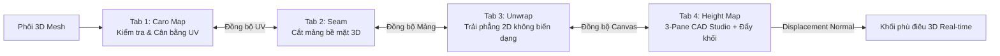
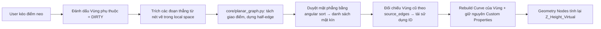
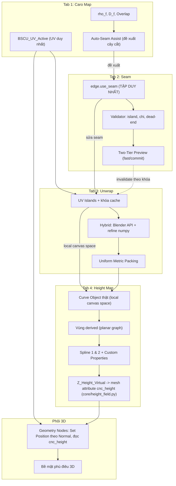

# ĐẶC TẢ THIẾT KẾ GIAO DIỆN & TRẢI NGHIỆM NGƯỜI DÙNG (UI/UX SPECIFICATION)
**Dự án:** Hệ thống Điêu khắc CNC 2.5D Tham số hóa trên Blender (BSCU)  
**Tài liệu:** Concept UI/UX Pipeline 4 Bước (Caro Map $\to$ Seam $\to$ Unwrap $\to$ Height Map)  
**Phiên bản:** 1.1.0 | **Trạng thái:** Thiết kế Khái niệm & Chuẩn tương tác — đã chốt quyết định vận hành (mục 1.1, 2.8, 3.8, 4.8, 5.10)  

---

## 1. TỔNG QUAN KIẾN TRÚC UI/UX & LUỒNG CÔNG VIỆC TỔNG THỂ

Hệ thống Addon BSCU được thiết kế để giải quyết bài toán cốt lõi: **Điêu khắc phù điêu tham số hóa trên các bề mặt phôi 3D cong lồi lõm phức tạp mà không làm méo tỷ lệ vector 2D**. 

Quy trình trải nghiệm người dùng tuân theo luồng tuyến tính 4 Tab (nhưng hỗ trợ đồng bộ dữ liệu hai chiều - Bi-directional Synchronization):



### Nguyên tắc UX Xuyên suốt (Core UX Principles)
1. **Phản hồi Tức thì (Zero-Latency Feedback):** Mọi thay đổi ở bất kỳ Tab nào (kéo caro, rạch seam, trải lưới, vẽ nét vector, kéo dot dốc) đều phản hồi ngay lập tức trên khung nhìn 3D Viewport mà không cần bấm nút "Apply" hay "Recalculate" thủ công.
2. **Khả nghịch & Đồng bộ Ngược (Non-Destructive & Bi-directional Sync):** Khi đang ở Tab 4 mà quay lại Tab 2 sửa đường Seam hoặc Tab 1 kéo giãn Caro, toàn bộ cấu trúc mảng 2D và hoa văn Height Map tự động cập nhật lại theo tọa độ UV mới mà không làm mất dữ liệu nét vẽ.
3. **Mô hình Trực quan Hóa (Visual Indicators):** Mọi biến dạng (Distortion), lỗi chồng lấn (Overlap), hoặc sai lệch diện tích đều có bản đồ nhiệt màu (Color Heatmap) cảnh báo trực quan cho người dùng.

### 1.1. Nền tảng Canvas 2D Dùng Chung (Shared 2D Canvas Foundation)

**Vì sao không dùng UV Editor / Image Editor của Blender:**
UV trong Blender gắn cứng vào loop của mesh — người dùng **không tạo được** đoạn thẳng, cung tròn hay đường cong mới bên trong UV Editor. Nhưng Tab 4 đòi Line / Arc 3-point / Spline / Fillet / Chamfer / Trim / Extend cùng Smart-Snap HUD. Blender cũng không có widget canvas 2D để nhúng. Đây là **ràng buộc API cứng**, không phải lựa chọn tuỳ ý.

**Quyết định:** một canvas 2D duy nhất, tự vẽ bằng GPU draw handler trong 3D Viewport, dùng chung cho Tab 2, Tab 3 và Tab 4.

| Đặc điểm | Chốt |
| :--- | :--- |
| Nơi vẽ | 3D Viewport, nhìn thẳng (orthographic) xuống mặt phẳng quy ước $z = 0$; mọi hình học 2D nằm trên mặt phẳng này |
| Đơn vị | 1 unit Blender = 1 mm thật; scene phải đặt `unit_settings` = Metric, đơn vị mm (BSCU kiểm tra và cảnh báo khi lệch) |
| Hit-test | Ray từ con trỏ xuống mặt phẳng $z=0$ — không phụ thuộc hình học 3D của phôi |
| Bắt điểm | Một bộ snap dùng chung: Endpoint, Midpoint, On-Curve, Intersection, cùng lưới và trục đã bật |
| Lớp nội dung | Tab = lớp được bật/tắt: Tab 2 = islands reflow, Tab 3 = bố cục đã trải, Tab 4 = nét vẽ + vùng + lưới dốc |
| Image Editor (UV) | Cửa sổ xem phụ **tuỳ chọn**, không phải nguồn sự thật, không dùng làm canvas vẽ |

**Ràng buộc hiệu năng:** chỉ dựng lại buffer hình học khi *input* thay đổi (kéo dot, đổi tham số, kết thúc thao tác), **không** dựng lại mỗi frame vô điều kiện; phần vẽ phải gom batch theo màu/trạng thái để giữ ≥ 60 fps.

**Hệ quả bắt buộc:** mọi công cụ bán trong Tab 4 là **modal operator tự viết** đi qua một lớp trừu tượng canvas duy nhất (`draw/canvas_2d.py`) — không dựa vào chế độ vẽ có sẵn nào của Blender.

---

## 2. TAB 1: CARO MAP — KIỂM TRA & CÂN BẰNG MẬT ĐỘ UV

### 2.1. Mục đích & Cơ chế Nền tảng
- **Mục tiêu:** Áp đặt lưới kiểm tra (Caro / Checker Map) lên phôi 3D để phát hiện các vùng co kéo, biến dạng hình học; cung cấp công cụ tự động và thủ công để dàn đều mật độ ô vuông trên toàn bộ bề mặt cong.
- **Hệ quả kỹ thuật:** Ô caro trên 3D càng đạt chuẩn tỉ lệ $1:1$ (hình vuông hoàn hảo) và kích thước bằng nhau trên mọi vị trí thì hoa văn 2D khi chiếu lên phôi 3D sẽ hoàn toàn không bị méo, không bị kéo dãn sọc hay ép dẹp rãnh điêu khắc.

```
+-----------------------------------------------------------------------+
|  [Tab 1: Caro Map]  |  Tab 2: Seam  |  Tab 3: Unwrap  | Tab 4: Height |
+-----------------------------------------------------------------------+
| [*] Chế độ Caro Overlay: [BẬT] (Tự động bật khi vào Tab)              |
|                                                                       |
| 1a. THIẾT LẬP CARO MAP (HIỆU CHUẨN TƯƠNG ĐỐI - THUẬT TOÁN)             |
| - Kích thước ô Caro (tương đối): [=====|=====] 10.0 mm/ô (suy ra)     |
|   * Mốc quy đổi rho* = median(mật độ texel toàn lưới), khử outlier MAD|
| - Kiểu hiển thị: (o) Caro Đen/Trắng   ( ) Lưới UV đánh số            |
| - Bản đồ nhiệt Biến dạng (Distortion Heatmap): [BẬT / TẮT]            |
|   [Xanh lá: Chuẩn 1:1] [Đỏ: Dãn >15%] [Xanh lam: Nén < -15%]          |
|                                                                       |
| 1b. AUTO-SEAM ASSIST (TỰ ĐỘNG ĐỀ XUẤT ĐƯỜNG CẮT)                      |
| - Kiểm tra topology: [!] CHƯA HỢP LỆ (chi != 1, còn 12 đỉnh chóp)     |
| - [ ~ PHÂN TÍCH & ĐỀ XUẤT ĐƯỜNG CẮT (Auto-Seam) ~ ]                  |
| - Mức độ cắt (Aggressiveness): [=====|=====] 0.45                    |
| - Dự báo trước khi áp: 4 mảng | Distortion RMS 2.1% | Overlap 0        |
|   [ ÁP DỤNG & TRẢI PHẲNG ]      [ Sang Tab 2 tinh chỉnh tay ]         |
|                                                                       |
| 2. CÂN BẰNG TỰ ĐỘNG (AUTOMATIC RELAX)                                 |
| - Thuật toán: [ARAP - As-Rigid-As-Possible   v]                       |
|   * Conformal (Bảo toàn góc vuông 90 độ)                              |
|   * ARAP (Cân bằng lực căng, đều diện tích)                           |
|   * Harmonic / Curvature-Weighted (Ưu tiên vùng cong gắt)             |
| - Số bước lặp (Iterations): [  100  ]                                 |
| - Tùy chọn: [*] Viền tự do (Free Boundary)  [ ] Ghim viền             |
| - Gióng trục lưới (Align to Axis): [ X/Y ]                            |
| - Chế độ đối xứng (Symmetry): [*] Trục X  [ ] Trục Y                  |
| - Phạm vi: (o) Toàn phôi (yêu cầu topology hợp lệ)  ( ) Vùng chọn     |
| - [ >> DÀN ĐỀU (Auto Relax) << ]                                     |
|                                                                       |
| 3. HIỆU CHỈNH CỤC BỘ (LOCAL SCULPT & TWEAK)                           |
| - Bút cọ 3D (Viewport Brushes) - [F: Cỡ cọ, Shift+F: Lực]             |
|   [ Relax Brush  ] : (Giữ Shift) Quét chuột xoa dịu vùng méo ô caro   |
|   [ Pinch Brush  ] : Quét chuột để thu nhỏ mật độ ô caro              |
|   [ Expand Brush ] : Quét chuột để phóng to mật độ ô caro             |
|   [ Grab Brush   ] : Kéo trượt ô caro sang vị trí khác                |
|   [ Twist Brush  ] : Xoay chiều lưới caro                             |
| - Bán kính bút (Radius): [ 25 mm ]  | Lực nhấn (Strength): [ 0.5 ]    |
| - [ Thư giãn Vùng chọn (Relax Selected Faces) ]                       |
|                                                                       |
| 4. ĐỒNG BỘ & TRẠNG THÁI                                               |
| * Distortion RMS: 1.8% | Overlap: 0 | Islands: 4 (Đạt chuẩn CNC)       |
| ! CẢNH BÁO: Biến dạng cực đại 22% tại đỉnh vòm -> chạy Auto-Seam      |
+-----------------------------------------------------------------------+
```

### 2.2. Chi tiết UX & So sánh Phần mềm Chuyên nghiệp
1. **Tham chiếu từ RizomUV & Substance Painter:**
   - **Tự động gán Material tạm thời (Temporary Viewport Shading Hook):** Ngay khi người dùng nhấp vào Tab 1, Addon tự động gán một Shader kiểm tra (Custom Node Group phát sinh procedural caro không phụ thuộc độ phân giải ảnh texture). Khi chuyển sang Tab khác hoặc xuất file, Shader này tự động ẩn đi, bảo toàn vật liệu gốc của người dùng.
   - **Bản đồ nhiệt 3 màu & Gợi ý Cắt Seam thông minh:**
     - $\text{Màu Xanh Lá } (\Delta \approx 0\%)$: Tỉ lệ ô vuông cân đối hoàn hảo.
     - $\text{Màu Đỏ } (\Delta > +15\%)$: Ô caro bị kéo giãn (Texture stretch) do bề mặt cong dốc.
     - $\text{Màu Xanh Lam } (\Delta < -15\%)$: Ô caro bị nén quá nhỏ (Texture pinch).
     - **Seam Hint:** Nếu hệ thống xoa dịu UV (Relax) không thể hạ độ dãn/nén xuống dưới ngưỡng 15%, chứng tỏ phôi cong quá gắt. Dưới panel lập tức hiện dòng cảnh báo khuyên người dùng sang Tab 2 để cắt Seam, kèm hiển thị nhấp nháy tại khu vực căng quá mức.
 2. **Tương tác trực tiếp trên 3D Viewport (3D Sculpt Relax) với chuẩn thao tác Blender:**
   - **Phím tắt quen thuộc:** Bấm `F` rê chuột để chỉnh kích thước cọ, `Shift + F` để chỉnh lực nhấn. Khi đang dùng cọ bất kỳ, giữ `Shift` quét chuột sẽ tự động chuyển sang chế độ Relax (Giống hệt Sculpt Mode).
   - **Đa dạng cọ (Brush Types):** Ngoài Relax (xoa dịu), Pinch/Expand (thu nhỏ/phóng to), còn bổ sung Grab (Kéo) và Twist (Xoay) để nắn lưới caro uốn lượn theo ý đồ thị giác.
   - **Đối xứng (Symmetry) & Viền tự do (Free Boundary):** Hỗ trợ cọ quét đối xứng qua trục X/Y để tiết kiệm thời gian. Mặc định thuật toán Relax chạy ở chế độ Viền tự do (không khóa mép phôi) để đảm bảo ô caro bên trong vuống vức tuyệt đối.
   - **Gióng trục (Align to Axis):** Cho phép nắn nhanh lưới caro thẳng song song với các trục X/Y của không gian 3D, rất quan trọng để khi đưa vào máy CNC, đường nét dọc/ngang không bị xéo (răng cưa).
 3. **Đồng bộ trạng thái:** Dữ liệu UV được lưu vào UV Map chuyên dụng `BSCU_UV_Active`. Khi quay lại Tab này ở bất kỳ thời điểm nào, việc điều chỉnh UV sẽ đồng bộ ngay lập tức sang các Tab sau.

### 2.3. Hiệu chuẩn Tương đối & Đặc tả Thuật toán (chốt)

**Nguyên tắc hiệu chuẩn — TƯƠNG ĐỐI, thuần thuật toán (không nhập tay, không chọn mẫu):**
Không tồn tại mốc vật lý tuyệt đối ở bước này. Mọi chỉ số đều quy chiếu về **chính lưới đang xét**:

| Đại lượng | Công thức | Ý nghĩa |
| :--- | :--- | :--- |
| Mật độ texel mỗi mặt | $\rho_f = \sqrt{A_{uv,f} / A_{3d,f}}$ | Tỉ lệ UV/mm² bề mặt. Đơn vị: UV/mm |
| Mốc chuẩn (khử outlier) | $\rho^* = \operatorname{median}_f(\rho_f)$ | Median bền vững hơn mean; chống lệch do vài mặt dị dạng |
| Biến dạng tỉ lệ | $\delta_f = \rho_f / \rho^* - 1$ | Nguồn của bản đồ nhiệt Đỏ/Lam |
| Ma trận Jacobian mặt | $J_f = [\vec{u}_1\ \vec{u}_2][\vec{e}_1\ \vec{e}_2]^{-1}$ | Ánh xạ 3D (tangent basis) $\to$ UV |
| Độ "vuông" (shear) | $s_f = \sigma_2/\sigma_1$ (trị suy biến của $J_f$) | $s_f = 1$: ô caro vuông hoàn hảo |
| Điểm biến dạng tổng hợp | $D_f = \sqrt{(\rho_f/\rho^* - 1)^2 + (1 - s_f)^2}$ | Nguồn của Distortion RMS / max |
| Số ô caro hiển thị | $n_{tiles} = 1 / (\rho^* \cdot K)$ | Để 1 ô $\approx K$ mm (tương đối); $K$ là slider |

**Miền đo (chốt phương án A):**
- **Đo** distortion $\rho_f, s_f, D_f$ trên **lưới Evaluated** (`depsgraph` — đã gồm Subdivision Surface) vì đó chính là bề mặt dao CNC ăn vào.
- **Sửa/relax UV** trên **Base Cage** (lưới gốc), trọng số truyền ngược theo diện tích mặt.
- **Chính sách cache:** khi đang kéo cọ (mỗi frame) $\to$ chỉ chạy solver cục bộ trên cage, **không** đánh giá lại depsgraph. Khi **thả chuột / kết thúc modal** $\to$ mới đánh giá lại evaluated và refresh heatmap.

### 2.4. Đặc tả Thuật toán Auto-Seam Assist (5 bước)

| Bước | Nội dung | Chi tiết |
| :--- | :--- | :--- |
| **B1. Chỉ số hình học** | Tính song song numpy toàn lưới | Góc khuyết $\delta(v) = 2\pi - \sum_i \theta_i$ (đỉnh chóp $\delta > 0$); góc nhị diện $\theta_e$; độ khuất $h(v)$ bằng raycast trục chính |
| **B2. Giá cắt mỗi cạnh** | Cạnh dài / ít gấp / mặt lộ = đắt | $c(e) = L_e \cdot (1 + \lambda_c \cdot \phi_{crease}(e)) \cdot h(e)$, $h = 0.3$ khuất, $1.0$ lộ |
| **B3. Cây cắt (Cut Graph)** | Đa nguồn Dijkstra (`heapq`) từ tập **đỉnh chóp** + **biên lưới** $\to$ hạ topology về dạng đĩa ($\chi = 1$) | Họ thuật toán Seamster (Sheffer & Hart 2002) |
| **B4. Dự báo (không ghi mesh)** | Unwrap thử **trong RAM trên bản sao** | Xuất: số mảng, Distortion RMS, Distortion max, **Overlap count** |
| **B5. Áp dụng / Bàn giao** | `[Áp dụng]` ghi `edge.use_seam` + relax per-island thật; `[Sang Tab 2]` nạp sẵn seam đề xuất; `Ctrl+Z` khôi phục bitmask seam cũ | 1 bước undo nguyên khối |

**Slider `Aggressiveness`** = ngưỡng $\delta$ phát hiện đỉnh chóp + ngân sách tổng chiều dài cắt. Kéo slider $\to$ chạy lại B3–B4 (debounce 150ms), **chưa** ghi vào mesh.

### 2.5. Ranh giới Tab 1 ↔ Tab 2 (chống trùng lặp — Single Source of Truth)

| Tiêu chí | Tab 1: Auto-Seam Assist | Tab 2: Seam Editor |
| :--- | :--- | :--- |
| Bản chất | **Tự động, theo thuật toán** — mục tiêu *mở khóa topology* để relax được | **Thủ công, phẫu thuật** — mục tiêu *mỹ thuật / chính xác* theo ý đồ |
| Cơ chế | Góc khuyết + nhị diện + Dijkstra đa nguồn | 4 công cụ tay: A-B Picker, Bisect Plane, Projection Silhouette, Face Cluster Border |
| Dữ liệu ghi | `mesh.edges[i].use_seam` | `mesh.edges[i].use_seam` **(cùng một tập duy nhất)** |
| Kết quả | Cây cắt gợi ý (màu tím, độ dày nét theo độ tin cậy) + bảng số liệu dự báo | Vệt Seam dạ quang do người dùng vạch |

Không tồn tại state seam thứ hai. Tab 1 chỉ *đề xuất*, Tab 2 *biên tập* — cùng ghi vào một tập cạnh.

### 2.6. Kiến trúc Module (bám chuẩn repo: file 300–500 dòng, `core/` thuần Python)

```
src/bscu/core/uv_metrics.py     # Jacobian, singular values, rho_f, rho*, D_f, overlap (numpy, KHÔNG bpy)
src/bscu/core/uv_relax.py       # ARAP / LSCM solver, numpy CG tự viết (KHÔNG scipy), xử lý nullspace
src/bscu/core/seam_graph.py     # góc khuyết, nhị diện, giá cắt, Dijkstra đa nguồn -> cut graph
src/bscu/bridge/mesh_adapter.py # Ranh giới DUY NHẤT chạm bpy: bpy.types.Mesh <-> mảng numpy
src/bscu/bridge/job_runner.py     # Hàng đợi + worker thread cho core/; apply kết quả trên main thread qua timer
src/bscu/nodes/checker_overlay.py    # Node group Caro procedural (không phụ thuộc ảnh texture)
src/bscu/properties/uv_properties.py # PropertyGroup Tab 1
src/bscu/operators/op_auto_seam.py   # Phân tích + đề xuất cây cắt
src/bscu/operators/op_uv_relax_all.py
src/bscu/operators/op_uv_brush.py    # Modal operator + GPU draw overlay (F / Shift+F / pressure)
src/bscu/ui/panel_caro_map.py
src/bscu/ui/panel_tabs.py         # Header 4 Tab (enum Scene.bscu_active_tab) dùng chung cho mọi sub-panel
```

**Ràng buộc kỹ thuật đã kiểm chứng trên máy này:**
- Dev python: `numpy 2.3.4` ✅ — `scipy` ❌ $\Rightarrow$ solver **phải** dùng Conjugate Gradient tự viết trên numpy.
- `core/` hiện chỉ dùng stdlib (`math`) — sẽ thêm `numpy`, **vẫn không import `bpy`** để unit test thuần Python chạy $< 1$s.
- **Không** dùng `mathutils` trong `core/` (chỉ tồn tại bên trong Blender $\Rightarrow$ làm hỏng unit test thuần Python).

### 2.7. Tiêu chí Nghiệm thu (Gate) cho Tab 1

- Distortion RMS sau relax $< 3\%$ trên bộ test: sphere, torus, saddle, phôi vòm CNC. **Overlap $= 0$.**
- Auto-Seam trên **sphere kín** (genus 0) phải đề xuất được cây cắt hợp lệ và kéo distortion từ $>15\%$ về $<3\%$.
- Thời gian: metric + auto-seam trên 200k tri $< 3$s (chạy nền có tiến trình); cọ brush $\geq 30$ fps.
- Unit test thuần Python: Jacobian trên lưới tổng hợp **đã biết trước** kết quả (mặt dãn $2\times$ theo U $\Rightarrow$ phải báo distortion $100\%$).

### 2.8. Quyết định vận hành đã chốt cho Tab 1

**D1 — Mô hình tính toán nền: worker thread cho `core/`, main thread cho `bpy`.**
- **Ranh giới:** `core/` (numpy thuần) chạy trên worker thread; **mọi** đọc/ghi `bpy` (đọc mesh, ghi `uv_layers`, đổi material slot, bật cờ "On Cage") chỉ chạy trên main thread, trong callback timer của modal operator.
- **Hợp đồng dữ liệu:** main thread trích mesh thành mảng numpy read-only → `queue.Queue`; worker trả kết quả về `queue.Queue`; timer của modal operator apply kết quả.
- `core/` không bao giờ nhận đối tượng `bpy`; mọi tham số đi qua mảng hoặc dataclass thuần.
- **Lý do:** `bpy` không thread-safe — đẩy cả pipeline vào thread sẽ crash ngẫu nhiên khi người dùng vẫn tương tác với scene.
- **Hệ quả:** Tab 2 và Tab 3 dùng **cùng** mô hình này, nhờ đó nhiều island có thể giải song song.

**D2 — Overlay Caro: material slot ở chế độ object-linked.**
- Khi vào Tab 1: tạo (nếu chưa có) một material slot phụ, gán `Material` Caro procedural với `slot.link = 'OBJECT'`.
- Vật liệu gốc của mesh (`link == 'DATA'`) **không bị chạm vào**; rời Tab chỉ cần trả `link = 'DATA'` và dọn slot phụ.
- **Khôi phục tự động** tại 5 mốc: rời Tab 1, đổi active object, đổi Object Mode, `bpy.app.handlers.save_pre` (trước khi lưu file), và `unregister()`.
- Shader do node group sinh (`nodes/checker_overlay.py`), **không phụ thuộc ảnh texture**: tần số lấy từ $\rho^*$ + hằng số $K$ của mục 2.3 nên 1 ô luôn ứng với $K$ mm thực, đổi được tức thì khi kéo slider.

**D3 — Cọ 3D tác động trực tiếp lên Base Cage (bật hiển thị "On Cage").**
- Bắt đầu cọ: bật cờ hiển thị lồi thô (cờ "On Cage" của Subsurf, hoặc tạm ẩn các modifier sinh bề mặt) để `ray_cast` trúng **đúng** lồi UV cần sửa.
- Ghi UV thẳng vào base cage — **không** cần bản đồ ánh xạ `evaluated ↔ cage` (bản đồ đó vỡ với Boolean/Mirror/Array vì sinh mặt không có cha tương ứng).
- Kết thúc / thả chuột / hủy: tắt cờ hiển thị, chạy lại metric trên `evaluated`, refresh heatmap — đúng chính sách cache ở mục 2.3.
- Nếu mesh không có cage dùng được (lồi gốc không tồn tại vì hình học sinh hoàn toàn từ modifier): **khoá chức năng cọ** và hiện lý do cụ thể, không fallback im lặng.
- Nguyên tắc đo/sửa giữ nguyên như mục 2.3: **đo trên `evaluated`, sửa trên `cage`**.

**D4 — Vỏ điều hướng: N-panel của 3D Viewport, trạng thái chia hai tầng.**
- 4 sub-panel dọc trong N-panel của 3D Viewport (tab category `BSCU`), chuyển tab bằng enum `Scene.bscu_active_tab` ⇒ giữ được tab đang mở khi đổi object hoặc mở file khác.
- `Object.bscu.*` (`properties/uv_properties.py`): **mọi tham số thuộc phôi** — chế độ overlay, kích thước ô, bật/tắt heatmap, thuật toán relax, số vòng lặp, đối xứng, mức độ cắt Auto-Seam, bán kính/lực cọ.
- `Scene.bscu_active_tab` + cờ overlay tạm: **trạng thái phiên làm việc**, không gắn vào object.
- Panel luôn bám theo `context.object` đang active; không có khái niệm "phôi được chọn" riêng.

---

## 3. TAB 2: SEAM — TÁCH MẢNG BỀ MẶT 3D THÔNG MINH

### 3.1. Mục đích & Cơ chế Nền tảng
- **Mục tiêu:** Cắt bề mặt phôi 3D phức tạp thành từng mảng độc lập (UV Islands/Patches) để khi trải phẳng ra không gian 2D, các mảng này không bị tự đè lên nhau (Self-overlapping) và không bị rách vỡ hình học.
- **Hệ quả kỹ thuật:** Phôi 3D dạng vòm, tượng thú, hoặc phù điêu uốn lượn có đặc tính topo kín hoặc nhiều hốc sâu. Cắt đường Seam chuẩn xác tại các nếp gấp tự nhiên (crease) hoặc ranh giới phân vùng giúp bản vẽ 2D Height Map trải phẳng tối đa diện tích hữu dụng.

```
+-----------------------------------------------------------------------+
|  Tab 1: Caro Map  |  [Tab 2: Seam]  |  Tab 3: Unwrap  | Tab 4: Height |
+-----------------------------------------------------------------------+
| CÁC CHẾ ĐỘ TẠO ĐƯỜNG SEAM (SEAM CREATION MODES)                       |
|                                                                       |
| 1. [ CHUỖI ĐƯỜNG SINH & ĐIỂM ĐẦU / CUỐI (Shortest Path Picker) ]      |
|    - Click chọn Điểm A -> Click chọn Điểm B: Tự động bắt đường ngắn   |
|      nhất bám theo đường sinh mô hình (Geodesic / Edge Loop).         |
|    - [ Đánh dấu Seam (Mark Seam) ]  [ Xóa Seam (Clear Seam) ]         |
|                                                                       |
| 2. [ MẶT PHẲNG THAM CHIẾU CẮT (Cutting Plane Bisect) ]               |
|    - Tạo mặt phẳng cắt: [ Dựng Mặt Phẳng Bisect ]                     |
|    - Tương tác Gizmo: Xoay / Tịnh tiến mặt phẳng cắt xuyên qua phôi.  |
|    - Phạm vi cắt: (o) Toàn bộ mô hình  ( ) Chỉ các mặt được chọn      |
|    - [ Cắt & Tạo Seam dọc giao tuyến (Slice & Mark Seam) ]            |
|                                                                       |
| 3. [ CHIẾU MẶT PHẲNG THAM CHIẾU (Projection Silhouette Boundary) ]    |
|    - Chọn góc nhìn hoặc mặt phẳng tham chiếu (Top / Front / Custom).   |
|    - Chiếu các mặt đang chọn lên mặt phẳng tham chiếu.                |
|    - [ Lấy Chu vi Viền bóng làm Seam (Silhouette to Seam) ]           |
|                                                                       |
| 4. [ ĐƯỜNG VIỀN TỔ HỢP MẶT (Face Cluster Perimeter) ]                 |
|    - Quét chọn 1 cụm mặt (Brush / Linked Flat Faces).                 |
|    - [ Tạo Seam bao quanh Vùng chọn (Border of Selection) ]           |
|                                                                       |
| KIỂM SOÁT & CẢNH BÁO TOPO (SEAM VALIDATOR)                            |
| - Số lượng mảng độc lập (Islands): 3 mảng                             |
| - Trạng thái Topo: [HỢP LỆ - Dạng Đĩa (Disk Topology Chi=1)]          |
| - Cảnh báo: [!] 2 đường cụt (dead-end) -> [ Nhảy tới điểm cụt ]       |
|                                                                       |
| HIỂN THỊ & PHỤ TRỢ                                                    |
| - Overlay Seam dạ quang dày: [BẬT] (không dùng vệt đỏ 1px mặc định)   |
| - Ẩn mảng đang chọn: [ Ẩn (Hide) ]   [ Hiện tất cả (Unhide) ]         |
|                                                                       |
| PREVIEW 2D LIÊN TỤC (TWO-TIER LIVE PREVIEW): [BẬT]                    |
| - Khi KÉO chuột : solver nhanh, chỉ island bị đổi, ~10 Hz             |
| - Khi COMMIT    : solver chuẩn (ARAP 100 iter) + kiểm Overlap         |
| - Trạng thái: [Đang tính...] Islands: 4 | Overlap: 0 | RMS: 2.1%      |
+-----------------------------------------------------------------------+
```

### 3.2. Chi tiết 4 Công cụ Tạo Seam Chuyên biệt
1. **Phương pháp 1: Shortest Path & Edge Loop Picking (Chuỗi liên tục)**
   - Người dùng click chọn đỉnh/cạnh bắt đầu (Start Segment), giữ `Ctrl` và click điểm kết thúc (End Segment).
   - Hệ thống dùng thuật toán Dijkstra có trọng số góc uốn (Angle-weighted shortest path) để tìm đường chạy tự nhiên men theo các rãnh võng của khối 3D.
   - Nhấn phím tắt `Space` để xác nhận gán thành Seam (hiển thị màu cam dạ quang nổi bật trên 3D).
2. **Phương pháp 2: Cutting Reference Plane (Mặt phẳng cắt Bisect)**
   - Tạo một Gizmo mặt phẳng ảo (Interactive Cutting Gizmo) trên Viewport.
   - Người dùng xoay mặt phẳng đến vị trí mong muốn (ví dụ: cắt đôi phôi đối xứng theo trục X).
   - Hệ thống thực hiện **cắt ảo** (không cắt hình học — xem D5 ở mục 3.8): dò chuỗi cạnh bị mặt phẳng cắt qua, chuẩn hoá thành chuỗi liên tục rồi đánh dấu toàn bộ làm Seam.
3. **Phương pháp 3: Projection Reference Plane (Chiếu & Lấy viền bóng Silhouette)**
   - Phù hợp với trường hợp phôi có góc nghiêng 2.5D phức tạp: Đặt mặt phẳng chiếu song song với hướng nhìn thiết kế chính.
   - **Thuật toán chuỗi viền bóng:** lấy mọi cạnh có hai mặt kề nằm khác phía so với hướng nhìn $\vec{d}$, tức $\big(\vec{n}_1 \cdot \vec{d}\big)\big(\vec{n}_2 \cdot \vec{d}\big) < 0$. Quét tuyến tính trên cảnh ($O(E)$), chính xác ngay cả với hốc lõm, và **không** cần bước ánh xạ ngược không xác định từ cạnh 2D về cạnh 3D.
4. **Phương pháp 4: Face Cluster Boundary (Đường bao tổ hợp mặt)**
   - Người dùng sử dụng công cụ Box Select hoặc Paint Select để quét chọn một mảng bề mặt (ví dụ: cánh hoa, mặt trán, vạt áo).
   - Bấm `[Border of Selection]`: Hệ thống lọc ra tất cả các cạnh biên chỉ có 1 mặt thuộc vùng chọn và 1 mặt nằm ngoài vùng chọn (`edge.is_boundary` đối với selection set) và gán `seam = True`.

### 3.3. Cơ chế Khắc phục Lỗi Topo (Seam Error Recovery)
- Nếu đường Seam bị hở (không khép kín thành chu vi hoặc không chạy ra mép ngoài của phôi), Tab 2 sẽ hiển thị cảnh báo: *"Cảnh báo: Tồn tại đường cắt cụt (Dead-end Seam) có thể gây méo khi trải phẳng"*, đồng thời highlight các điểm đầu mút cụt bằng vòng tròn nhấp nháy màu vàng để người dùng nối kín.

**Chỉ số kiểm toán Topology (Seam Validator):**

| Chỉ số | Công thức / Cách xác định | Ngưỡng hợp lệ |
| :--- | :--- | :--- |
| Số mảng | Số thành phần liên thông của đồ thị mặt sau khi cắt theo tập Seam | $\ge 1$ |
| Đặc trưng Euler mỗi mảng | $\chi = V - E + F$ | $\chi = 1$ (dạng đĩa) là mục tiêu; $\chi = 2$ còn kín $\Rightarrow$ chưa cắt tới; $\chi < 1$ có lỗ/handles |
| Điểm cụt (Dead-end) | Đỉnh có **đúng 1** cạnh Seam kề | Phải $= 0$ |
| Đỉnh chóp còn sót | $\delta(v) = 2\pi - \sum_i \theta_i > \tau$ mà không nằm trên cây cắt | Phải $= 0$ |
| Chồng lấn sau trải | Đếm cặp mặt giao nhau trong không gian UV | Phải $= 0$ |

### 3.4. Kiến trúc Preview 2D Liên tục (Two-Tier Live Preview) — chốt phương án C

**Vấn đề:** unwrap lại toàn phôi theo từng frame ở mức 200k tam giác là bất khả thi về mặt tính toán. Phương án C chỉ khả thi nếu chia làm 2 tầng chất lượng:

| Tầng | Kích hoạt | Phạm vi | Solver | Tần suất | Mục đích |
| :--- | :--- | :--- | :--- | :--- | :--- |
| **Preview nhanh** | Trong lúc **kéo/di chuột** | Chỉ các **island bị ảnh hưởng** bởi đường cắt tạm | LSCM warm-start, `iterations = 5`, chạy trên **cage** | Throttle **100 ms** ($\approx 10$ Hz) | Phản hồi thị giác tức thì, không khóa UI |
| **Kết quả chuẩn** | Khi **commit** (Space / thả chuột) | Cùng các island bị ảnh hưởng | ARAP đầy đủ, `iterations = 100`, đo trên **evaluated** | 1 lần / thao tác | Số liệu chính thức: RMS, Overlap, χ |

**Cơ chế cache (điều kiện để C chạy nổi):**
- Khóa cache mỗi island: `hash(frozenset(edge_ids))` từ tập cạnh Seam của island đó.
- Chỉ island có khóa thay đổi mới bị **invalidate** và tính lại. Các island còn lại giữ nguyên kết quả cũ (không tính lại).
- Khi đang kéo: đường cắt đang chọn là **tạm thời** (chưa ghi `use_seam`). Hệ thống cắt ảo trong RAM, tính lại chỉ phần bị ảnh hưởng, rồi vẽ.
- Kiểm Overlap **tăng dần**: spatial hash theo bbox UV của từng mặt; chỉ đối chiếu trong phạm vi island vừa đổi.
- Nếu worker chưa xong trong 100 ms: giữ khung preview cũ + hiện hiệu ứng "Đang tính..." (không chặn thao tác).

### 3.5. Hiển thị & Phụ trợ (đã chốt, không cần lựa chọn)
- **Overlay Seam dạ quang dày:** không dùng vệt đỏ 1 pixel mặc định của Blender (vô hình trên phôi lồi lõm). Vẽ bằng GPU draw handler: đường dày, phát sáng, nổi rõ trên mọi góc nhìn.
- **Ẩn mảng đang chọn (`Hide Island`):** khi cắt được một cục, ẩn nó đi để nhìn/rạch được vào các hốc sâu bên trong. Có nút khôi phục toàn bộ.
- **Cây cắt gợi ý từ Tab 1:** nếu người dùng bấm `[Sang Tab 2 tinh chỉnh tay]` ở Auto-Seam Assist, tập Seam đề xuất được nạp sẵn và highlight để biên tập tiếp.

### 3.6. Module cho Tab 2 (bám chuẩn repo: file 300–500 dòng, `core/` thuần Python)

```
src/bscu/core/uv_islands.py      # Tách island từ tập seam, đếm island, chi = V-E+F, phát hiện dead-end
src/bscu/core/unwrap_solver.py   # LSCM/ARAP hai tầng (preview warm-start + full), overlap check tăng dần
src/bscu/core/uv_metrics.py      # Dùng lại từ Tab 1 (rho_f, D_f)
src/bscu/core/seam_graph.py      # Dùng lại từ Tab 1 (Dijkstra trọng số góc uốn cho A-B Picker)
src/bscu/bridge/mesh_adapter.py  # Mở rộng: bisect ảo, transfer UV khi topology đổi
src/bscu/operators/op_seam_picker.py    # A-B Picker (modal, Ctrl+click, Space commit)
src/bscu/operators/op_seam_bisect.py    # Cutting Plane Bisect + Gizmo
src/bscu/operators/op_seam_project.py   # Projection Silhouette
src/bscu/operators/op_seam_cluster.py   # Face Cluster Perimeter
src/bscu/operators/op_seam_validate.py  # Kiểm toán topo + nhảy tới điểm cụt
src/bscu/ui/panel_seam.py
src/bscu/draw/canvas_2d.py      # Canvas 2D dùng chung Tab 2/3/4: nền tảng định nghĩa ở mục 1.1
src/bscu/draw/seam_overlay.py   # GPU draw handler: seam dạ quang + khung preview 2D
```

### 3.7. Tiêu chí Nghiệm thu (Gate) cho Tab 2
- Preview lúc kéo duy trì $\ge 10$ Hz trên phôi 200k tri, **không khóa UI thread** (thao tác được liên tục khi đang tính).
- Chỉ số island và $\chi$ hiển thị **đúng 100%** trên bộ test tổng hợp đã biết trước kết quả.
- Phát hiện dead-end đúng **100%** trên bộ ca nhân tạo (đường cắt cố ý bỏ lửng).
- Commit một đường seam $\to$ số liệu chuẩn cập nhật $\le 2$s trên 200k tri.
- Unit test thuần Python: đếm island + $\chi$ + dead-end trên lưới chắp ghép (không cần Blender).

### 3.8. Quyết định vận hành đã chốt cho Tab 2

**D5 — Cutting Plane Bisect: cắt ảo, mesh bất biến.**
- Dò chuỗi cạnh bị mặt phẳng gizmo cắt qua (raycast/điểm gần nhất mỗi cạnh lên mặt phẳng), chuẩn hoá thành chuỗi liên tục, rồi gán `use_seam` trong **một** bước undo.
- **Không** dùng `bmesh.ops.bisect_plane`: hàm này sinh cạnh mới cắt ngang mặt, làm hỏng UV các mặt bị cắt và phá vỡ ánh xạ cage ↔ evaluated đã chốt ở D3.
- Nhu cầu tách mesh vật lý (để gán vật liệu khác) **nằm ngoài phạm vi BSCU** — người dùng dùng Bisect sẵn có của Blender.

**D6 — Preview 2D dùng chung canvas 2D của mục 1.1.**
- Tab 2 không có bản preview riêng: nó bật **lớp nội dung "islands reflow"** trên canvas 2D dùng chung, và tự sắp xếp area khi cần.
- Nhờ vậy chỉ có **một** hệ toạ độ và **một** bộ hit-test/snap cho cả Tab 2, Tab 3, Tab 4, thay vì ba bản hiển thị không đồng bộ.

**D7 — Cache island và cách nhận diện island.**
- Khóa cache: `hash(frozenset(edge_ids))` của tập cạnh seam thuộc island; chỉ island có khóa đổi mới bị invalidate (cơ chế đầy đủ ở mục 3.4).
- Cache **chỉ sống trong RAM trong phiên làm việc**, không ghi ra file: island là dữ liệu dẫn xuất, tái tính được từ `BSCU_UV_Active` + tập seam.
- Island luôn được nhận diện lại theo **tập mặt 3D gốc**, **không** theo `island_id` (ID có thể đổi khi người dùng sửa seam) — khớp với quy tắc 3 ở mục 6.

---

## 4. TAB 3: UNWRAP — TRẢI PHẲNG MẶT 3D THÀNH BẢN RẬP 2D

### 4.1. Mục đích & Cơ chế Nền tảng
- **Mục tiêu:** Dựa trên các đường Seam đã phân chia ở Tab 2, trải phẳng các mảng 3D thành các tấm phẳng 2D (Bản rập UV / Flattened Canvases).
- **Hệ quả kỹ thuật:** Mỗi tấm phẳng 2D sẽ đóng vai trò là một "Tờ giấy vẽ CAD" ở Tab 4. Bất kỳ nét vẽ hoặc độ cao nào sinh ra trên tờ giấy 2D này sẽ được chiếu ngược tức thì lên đúng mảng 3D tương ứng.

```
+-----------------------------------------------------------------------+
|  Tab 1: Caro Map  |  Tab 2: Seam  |  [Tab 3: Unwrap]  | Tab 4: Height |
+-----------------------------------------------------------------------+
| THUẬT TOÁN TRẢI PHẲNG (HYBRID ENGINE)                                 |
| - Tầng 1 (solver nền, API Blender chạy bằng C):                       |
|   * uv.unwrap(method='ANGLE_BASED')  ~= ABF++                         |
|   * uv.average_islands_scale()  -> cân bằng mật độ texel mọi island   |
| - Tầng 2 (lớp refine numpy của BSCU, tối ưu trực tiếp chỉ số D_f):    |
|   * Số bước lặp tinh chỉnh: [ 100 ]                                   |
|   * Chốt chặn Overlap: [BẬT]  (rollback nếu overlap tăng)             |
|                                                                       |
| BỐ TRÍ MẢNG PHẲNG (ISLAND PACKING & LAYOUT)                          |
| - Xoay căn chỉnh thớ gỗ/trục gia công (Align Longest Axis): [BẬT]     |
| - Khoảng cách đệm an toàn giữa các mảng (Margin): [ 5.0 mm ]         |
| - Tỷ lệ đồng nhất (Uniform Real-World Scale): [ 1.0 mm 2D = 1.0 mm 3D]|
|                                                                       |
| DANH SÁCH CÁC MẢNG ĐÃ TRẢI (UNWRAPPED ISLANDS)                        |
| [>] Mảng 1: Bề mặt trung tâm (Diện tích: 120x85 mm)  [Chọn để vẽ ở T4]|
| [>] Mảng 2: Viền vòm bên trái (Diện tích: 45x150 mm) [Chọn để vẽ ở T4]|
| [>] Mảng 3: Viền vòm bên phải (Diện tích: 45x150 mm) [Chọn để vẽ ở T4]|
|                                                                       |
| BẢO TRỢ BIẾN DẠNG & CHỒNG LẤN                                         |
| - Trùng đè mảng (Overlaps): 0 phát hiện [AN TOÀN]                     |
| - Độ biến dạng diện tích cực đại: 2.1%                                |
|                                                                       |
| [ >> TIẾN VÀO TAB 4 ĐỂ VẼ HOA VĂN & BƠM KHỐI << ]                     |
+-----------------------------------------------------------------------+
```

### 4.2. Chi tiết UX Tương tác & Khung nhìn Kép (Dual Viewport Layout)
1. **Bố cục khung nhìn tự động:** Khi người dùng chuyển sang Tab 3, Blender tự động chia màn hình thành 2 cửa sổ:
   - **Bên phải:** 3D Viewport phôi thật (giúp quan sát mảng nào đang được kích hoạt).
   - **Bên trái:** canvas 2D dùng chung của mục 1.1 (một 3D Viewport ở chế độ canvas) hiển thị các mảng đã trải phẳng trên nền lưới milimet chính xác.
   - Cả hai vùng đều là 3D Viewport: người dùng vẫn tự do xoay/zoom cửa sổ phôi; vùng canvas chỉ khoá hướng nhìn khi con trỏ nằm bên trong nó.
2. **Tương tác Chọn đồng bộ (Synchronized Selection):**
   - Click chuột vào một mảng trên 2D $\to$ Mảng tương ứng trên mô hình 3D phát sáng (Highlight viền cam).
   - Ngược lại, click chọn bất kỳ mặt nào trên 3D $\to$ Tự động focus vào mảng 2D tương ứng trên bản rập.
3. **Cơ chế Cập nhật Ngược - Xuôi (Bi-directional Reactivity):**
   - Nếu người dùng quay lại Tab 2 thêm/xóa đường Seam, hệ thống tự động chạy lại thuật toán Unwrap ở chế độ nền. Khi trở lại Tab 3, danh sách mảng đã được làm mới hoàn toàn.
   - Các mảng 2D được chuẩn hóa tỷ lệ theo thế giới thực ($1:1$ Metric Scale) để kích thước mm của chi tiết điêu khắc trên bản rập khớp chính xác với dao phay CNC ngoài thực tế.

### 4.3. Động cơ Hybrid 2 Tầng (chốt phương án C)

| Tầng | Công cụ | Vai trò | Lý do chọn |
| :--- | :--- | :--- | :--- |
| **Tầng 1 — Solver nền** | `uv.unwrap(method='ANGLE_BASED')`<br>`uv.average_islands_scale()`<br>`uv.minimize_stretch(iterations=100)`<br>`uv.pack_islands(margin, rotate, scale)` | Trải phẳng thô + cân bằng mật độ texel + dàn đều lực căng + xếp mảng | Đã là C code trong Blender: nhanh, ổn định, không nên viết lại |
| **Tầng 2 — Refine của BSCU** | Solver numpy trong `core/uv_refine.py` | Tối ưu **trực tiếp** chỉ số $D_f$ đã định nghĩa ở mục 2.3, kèm **chốt chặn Overlap** | Blender tối ưu theo metric của nó, không đảm bảo ngưỡng RMS $<3\%$ của ta |

**Điều kiện dừng của Tầng 2:** $D_f^{RMS} < 3\%$ **hoặc** chạm `max_iterations`. Nếu overlap **tăng** so với trước khi refine $\Rightarrow$ **rollback** về kết quả Tầng 1 (không bao giờ để refine làm hỏng bản trải).

**Bắt buộc:** `uv.average_islands_scale()` phải luôn chạy. Nếu mỗi island giữ một mật độ texel khác nhau thì hoa văn ở Tab 4 sẽ **to nhỏ khác nhau giữa các mảng** dù cùng một nét vẽ — đây là lỗi âm thầm nguy hiểm nhất của cả pipeline.

### 4.4. Packing theo Tỉ lệ Thật (Uniform Metric Packing)

- **Không** scale tự do từng island. Toàn bộ island dùng **một hệ số scale duy nhất**, suy ra từ $\rho^*$ của Tab 1.
- Margin tính bằng **mm thực**, không phải đơn vị UV.
- **Khổ canvas gia công ($W \times H$ mm) là tuỳ chọn nhưng có cảnh báo:** nếu bản rập vượt khổ nhập, panel hiện cảnh báo kèm kích thước thực tế; BSCU **không** tự thu nhỏ bản rập, vì tự đổi tỷ lệ sẽ phá cam kết tỷ lệ $1:1$ ở chính mục này.
- **Align Longest Axis:** xoay island sao cho trục dài nhất song song trục chạy dao — giảm răng cưa khi gia công và giữ hướng thớ vật liệu.

### 4.5. Đồng bộ Hai chiều & Cache (tái dùng từ Tab 2)
- Bảng ánh xạ `island_id ↔ tập mặt 3D` là **nguồn sự thật duy nhất** cho việc chọn đồng bộ.
- Quay lại Tab 2 sửa Seam $\Rightarrow$ chỉ **invalidate đúng island có khóa `hash(frozenset(edge_ids))` thay đổi**, các island còn lại giữ nguyên kết quả (tái dùng cơ chế cache ở mục 3.4).
- Không có state UV thứ hai: `BSCU_UV_Active` vẫn là kênh UV duy nhất xuyên suốt 4 Tab.

### 4.6. Module cho Tab 3

```
src/bscu/core/uv_refine.py       # Tầng 2: refine numpy tối ưu D_f + overlap guard + rollback
src/bscu/core/uv_islands.py      # Dùng lại: danh sách island, diện tích mm, khóa cache
src/bscu/bridge/uv_bridge.py     # Gọi bpy.ops.uv.* đúng context/override, đồng bộ selection
src/bscu/operators/op_unwrap_all.py
src/bscu/operators/op_pack_islands.py
src/bscu/ui/panel_unwrap.py
src/bscu/draw/island_overlay.py  # Highlight island tương ứng giữa 2D và 3D
```

### 4.7. Tiêu chí Nghiệm thu (Gate) cho Tab 3
- $D_f^{RMS} < 3\%$ sau refine trên bộ test (sphere, torus, saddle, phôi vòm CNC).
- **Overlap $= 0$**; nếu refine làm overlap tăng thì phải rollback (kiểm bằng test tiêm lỗi cố ý).
- Chênh lệch mật độ texel giữa các island $< 1\%$ sau `average_islands_scale()`.
- Sửa 1 đường Seam $\Rightarrow$ **chỉ** island bị ảnh hưởng được tính lại (đo bằng bộ đếm số lần gọi solver).
- Layout 2 khung nhìn (3D $|$ 2D) tự mở đúng, chọn đồng bộ hai chiều hoạt động.

### 4.8. Quyết định vận hành đã chốt cho Tab 3

**D8 — Chuỗi lệnh chuẩn: chạy lại `average_islands_scale()` sau khi refine.**

$$\text{unwrap} \to \text{average\_islands\_scale} \to \text{minimize\_stretch}(100) \to \textbf{refine}(D_f) \to \text{average\_islands\_scale} \to \text{pack\_islands}$$

- Tầng 2 chỉ tối ưu hình dạng trong không gian UV, **không** giữ đẳng nhất mật độ texel giữa các island; thiếu bước đồng nhất lần hai thì gate "chênh lệch $< 1\%$" ở mục 4.7 mất hiệu lực.
- Bước đồng nhất lần hai là C code sẵn có nên chi phí không đáng kể.
- **Số liệu chính thức báo cho người dùng được đo lại sau bước cuối**, không dùng số đo tức thời trước khi pack.
- Quy tắc rollback giữ nguyên: nếu refine làm overlap tăng, quay lại kết quả Tầng 1 rồi đi tiếp phần đồng nhất và pack.

**D9 — Khổ canvas: chỉ cảnh báo, không tự thu nhỏ.**
- Nhập khổ $W \times H$ (mm) là tuỳ chọn; nếu bản rập vượt khổ, panel hiện cảnh báo kèm kích thước thực tế của bản rập.
- BSCU **không** tự thu nhỏ hay thu phóng bản rập để vừa khổ: bất kỳ tỷ lệ nào khác $1:1$ đều phá cam kết kích thước mm ở mục 4.4 và làm sai kích thước chi tiết đúc.


---

## 5. TAB 4: HEIGHT MAP — 3-PANE CAD STUDIO & ĐIỀU KHIỂN KHỐI REAL-TIME

### 5.1. Bố cục 3 Cột Studio Chuyên Biệt (3-Pane Studio Layout)
> **Ánh xạ 3 cột này vào khung cửa sổ Blender** xem D12 ở mục 5.10.


```
+--------------------+------------------------------------------+-----------------------+
|  LEFTBAR (Layers)  |         CENTERBAR (2D CAD Canvas)        |  RIGHTBAR (Inspector) |
+--------------------+------------------------------------------+-----------------------+
| [Eye] [Lock] [Add] | - Navigation: Pan (MMB), Zoom (Scroll)   | [Context: Line/Region]|
|                    | - Snap: End, Mid, Nearest, Intersect     | - Height: 10.0mm      |
| [>] Group 1        | - Draw: Line, Arc 3-pt, Spline           | - Blend: Add / Sub    |
|   [*] Layer Nét vẽ | - Edit: Fillet, Chamfer, Trim, Extend    |                       |
|   [o] Layer Màu sắc| - Associativity: Sửa nét -> Vùng tự nhảy | [Biểu đồ Spline dốc]  |
|   [#] Layer Vùng   | - Region Manipulator: Mạng lưới đường    |   /‾‾\____  (Dot sel) |
|                    |   sinh dốc (UV Grid) & Dot kéo thả       |                       |
| (Drag-drop z-order)|   trực tiếp trên Viewport 2D             | [Biểu đồ Cắt vuông góc|
+--------------------+------------------------------------------+-----------------------+
```

### 5.2. Leftbar — Quản lý Layer Phân tầng (Photoshop Style)
- **Công cụ Header:**
  - Nút Mắt (`Eye`): Bật/Tắt ẩn hiện toàn bộ nét vẽ và độ cao của Layer trên 3D Viewport.
  - Nút Khóa (`Lock`): Đóng băng Layer chống chỉnh sửa vô ý.
  - Nút Thêm Mới (`Add Layer`): Tạo Layer rỗng.
  - Nút Tạo Nhóm (`Add Group`): Gom cụm nhiều Layer (ví dụ: "Nhóm Hoa Văn Sen", "Nhóm Chữ").
- **Tương tác Kéo thả (Drag & Drop Z-Order):**
  - Thứ tự Layer từ trên xuống dưới quy định thứ tự phủ đè độ cao: Layer nằm trên sẽ đè (Override hoặc Blend) lên Layer nằm dưới.
- **3 Kiểu Layer Chuyên dụng (Thiết lập qua chuột phải hoặc Icon):**
  1. **Layer Nét vẽ (Carving Stroke):**
     - Chứa các đường vector dẫn đường (Open hoặc Closed curves).
     - Dùng để tính toán rãnh vát chữ V (V-Carving), rãnh chỉ, khắc rãnh tròn (Ball-nose), hoặc đường chỉ bao.
  2. **Layer Màu sắc (Color Tint):**
     - Dùng để tô màu trực tiếp hoặc gán vật liệu riêng biệt (sơn thếp vàng, tạo màu gỗ khác tone) mà không làm biến đổi hình thái độ cao.
  3. **Layer Vùng (Bounded Region):**
     - Tự động sinh ra khi các nét vẽ của *Layer Nét vẽ* giao nhau tạo thành một chu trình khép kín.
     - Chịu trách nhiệm đắp khối phù điêu dương ($Add$) hoặc khoét lòng chảo âm ($Subtract$).

### 5.3. Centerbar — Môi trường Tương tác 2D CAD & Lưới Nắn Dốc
- **Thao tác Khung nhìn Chuẩn CAD:**
  - `MMB Drag`: Pan khung nhìn mượt mà.
  - `Scroll Wheel`: Zoom tụ điểm tại con trỏ chuột.
  - `LMB Click / Drag`: Chọn đối tượng hoặc quét vùng chọn (Box / Marquee Selection).
- **Hệ thống Bắt điểm Thông minh (Smart Snapping HUD):**
  - Hiển thị ký hiệu bắt điểm động khi rê chuột gần hình học:
    - **Endpoint (Điểm đầu mút):** Hình vuông màu xanh lá $\Box$.
    - **Midpoint (Trung điểm đoạn):** Hình tam giác màu vàng $\triangle$.
    - **Nearest on Curve (Điểm trên đường):** Hình chữ X màu cam $\times$.
    - **Intersection (Giao điểm giữa 2 đường):** Ký hiệu dấu cộng đỏ $+$.
- **Bộ Công cụ Vẽ & Biến đổi Hình học (CAD Precision Tools):**
  - `Line Tool`: Vẽ đoạn thẳng chính xác theo góc và chiều dài nhập số.
  - `Arc 3-Point Tool`: Vẽ cung tròn đi qua 3 điểm (Start, End, Midpoint).
  - `Spline / Bezier Tool`: Vẽ đường cong mượt với các điểm neo (Anchor Points) và tay đòn tiếp tuyến (Tangent Handles).
  - `CAD Modifiers`:
    - **Fillet (Bo góc tròn):** Chọn 2 đoạn giao nhau $\to$ Bo tròn với bán kính $R$.
    - **Chamfer (Vát góc thẳng):** Vát mép thẳng với kích thước $D$.
    - **Trim (Cắt tỉa):** Click vào đoạn thừa phía sau giao điểm để xóa bỏ tức thì.
    - **Extend (Phóng dài):** Kéo dài đường thẳng tới khi chạm vào đường biên gần nhất.
- **Tính Liên đới Hình thái (Topological Associativity - Planar Graph):**
  - Giữa *Layer Nét vẽ* và *Layer Vùng* có sự gắn kết logic liên tục. Khi người dùng dùng công cụ di chuyển một điểm neo của đường nét, toàn bộ các Vùng kín tiếp giáp đường nét đó tự động biến dạng theo mà không cần người dùng vẽ lại vùng kín.
- **Bộ Nắn Đường Sinh Dốc Cục Bộ (Region Slope Grid Manipulator):**
  - Khi người dùng click chọn 1 Vùng kín trên Centerbar:
    - Lập tức một mạng lưới đường sinh dốc nội suy (Patch Flow Lines / UV Grid) phủ kín bên trong vùng đó.
    - Trên các giao điểm xuất hiện các điểm điều khiển (Control Dots).
    - Người dùng có thể kéo thả các Dot này để nâng cao cục bộ hoặc hạ thấp một góc của vùng phù điêu (ví dụ: làm cánh hoa phồng ở giữa nhưng xẹp dẹp ở mép cuống).

### 5.4. Rightbar — Bảng Thuộc tính Ngữ cảnh & Hệ Thống Biểu Đồ Dốc Đôi (Dual-Spline Profile Editor)
> **Lưu ý bố cục:** hình vẽ minh hoạ *nội dung* của Inspector. Hai biểu đồ thực tế được vẽ như một lớp HUD neo trong vùng canvas 2D, không nằm trong N-panel — xem D11 ở mục 5.10.


```
+-------------------------------------------------------+
| RIGHTBAR INSPECTOR                                    |
+-------------------------------------------------------+
| ĐỐI TƯỢNG ĐANG CHỌN: [ VÙNG: Cánh Hoa Trung Tâm ]      |
|                                                       |
| THÔNG SỐ ĐỘ CAO CƠ BẢN                                |
| - Chiều cao cơ sở (Base Height): [ 8.0 mm ]           |
| - Phương thức đắp: (o) Add (Đắp dương)  ( ) Subtract   |
| - Góc vát chân (Bevel Angle): [ 45.0 ° ]              |
|                                                       |
| HỆ THỐNG BIỂU ĐỒ PROFILE ĐÔI (DUAL-SPLINE SYSTEM)     |
|                                                       |
| 1. BIỂU ĐỒ CHÍNH (Spline 1: Master Profile Curve)     |
|    Biến thiên độ cao theo khoảng cách từ biên vào tâm: |
|    Height                                             |
|     ^     [Dot 1]                                     |
|     |       /‾‾\________ [Dot 2]                      |
|     |      /                                          |
|     +----------------------------> Distance           |
|    (Click chọn 1 Dot để mở Biểu đồ Cắt vuông góc)     |
|                                                       |
| 2. BIỂU ĐỒ CẮT VUÔNG GÓC (Spline 2: Cross-Section)    |
|    Đang hiệu chỉnh cho: [ Dot 1 - Đỉnh Vòm ]           |
|    Độ dốc theo phương tiếp tuyến / vuông góc lát cắt: |
|    Height                                             |
|     ^        /\                                       |
|     |       /  \   (Vòm nhọn Gothic)                  |
|     |      /    \                                     |
|     +----------------------------> Width              |
|                                                       |
| ĐỐI TƯỢNG ĐANG CHỌN: [ ĐƯỜNG: Rãnh Gân Lá ]           |
| - Profile dao đục: [ Ball-nose R3 mm  v]              |
| - Chiều sâu đục (Cut Depth): [ -2.5 mm ]              |
| - Biểu đồ Spline 2 cho Đường: Độ sâu biến thiên dọc nét|
+-------------------------------------------------------+
```

1. **Tự động Chuyển Đổi Ngữ Cảnh Theo Selection:**
   - **Khi chọn Đường (Stroke):** Inspector hiển thị đường kính dao (`tool_radius`), kiểu dao (`V-Bit`, `Ball-nose`, `End-mill`), độ sâu rãnh đục, và biểu đồ biến thiên độ sâu dọc theo chiều dài đường nét.
   - **Khi chọn Vùng (Region):** Inspector hiển thị độ cao đắp nổi ($Add$) hoặc khoét lõm ($Subtract$), góc vát chân, và kích hoạt Hệ thống Biểu đồ Profile Đôi.
2. **Hệ Thống Biểu Đồ Đôi (Dual-Spline Profile Editor):**
   - **Spline 1 (Biểu đồ Master):**
     - Trục hoành ($X$): Khoảng cách chuẩn hóa từ mép viền ngoài vào tâm vùng ($0.0 \to 1.0$).
     - Trục tung ($Y$): Chiều cao tương đối ($0.0 \to 1.0$).
     - Thể hiện dáng khối tổng quát: Mặt phẳng vát hộp, vòm cong elip, hay chóp nhọn.
     - Trên đường cong Spline 1 có các điểm neo (Dots) có thể thêm/bớt/kéo thả.
   - **Spline 2 (Biểu đồ Mặt cắt Ngang Cross-Section):**
     - Khi người dùng click chọn 1 Dot cụ thể trên Spline 1, Spline 2 xuất hiện ngay bên dưới.
     - **Đối với Vùng:** Spline 2 điều khiển độ dốc và biên dạng cong theo phương tiếp tuyến vuông góc với mặt cắt đi qua Dot đó. Điều này cho phép tạo các bề mặt phù điêu vặn xoắn phức tạp (như nếp gấp áo lượn sóng) mà đồ thị 1D truyền thống không làm được.
     - **Đối với Đường:** Spline 2 định nghĩa tiết diện lát cắt của đường rãnh tại vị trí đó (đầu nét vuốt nhọn, thân nét sâu đều, đuôi nét thoai thoải).

### 5.5. Kiến trúc Lưu trữ Canvas (chốt: Curve Object thật + HUD của canvas 2D)

| Thành phần | Biểu diễn trong Blender | Ghi chú |
| :--- | :--- | :--- |
| **Layer Nét vẽ** | `bpy.types.Curve` (Bezier/NURBS), `use_cyclic_u` tùy nét | Nguồn sự thật của hình học |
| **Layer Vùng** | `bpy.types.Curve` với `fill_mode = 'BOTH'`, đánh dấu `derived = True` + `source_edges` | Sinh tự động, **không** vẽ tay |
| **Layer Màu sắc** | `bpy.types.Curve` (nét có `bevel_depth`) hoặc vùng có `fill_mode` | Chỉ ảnh hưởng vật liệu, **không** ảnh hưởng độ cao |
| **Nhóm Layer** | `bpy.data.collections` lồng nhau | Kéo thả Z-order = thứ tự collection |
| **Siêu dữ liệu** | Custom Properties trên object (`cnc_base_height`, `cnc_bevel_angle`, `cnc_bevel_depth`, `cnc_profile_shape`, `cnc_blend_mode`, `cnc_tool_radius`, `cnc_tool_profile`) | Khớp đúng mục 4 của `brainstorming.md` |
| **HUD (Snap, Grid dốc, Dot, biểu đồ đôi)** | Một lớp HUD của canvas 2D (`draw/canvas_2d.py`) | Không bake vào hình học, thuần hiển thị/thao tác — xem D11 |

**Không gian toạ độ — điểm quyết định:**
- Mỗi **island** từ Tab 3 có một **khung toạ độ canvas cục bộ (Local Canvas Space)** đặt trên mặt phẳng 2D, kích thước đúng bằng kích thước thật của mảng (mm).
- Người dùng vẽ trong local space của island. Khi bơm khối, hệ thống biến đổi Local Canvas $\to$ UV của island đó $\to$ bề mặt 3D.
- Nhờ vậy: hoa văn **không bị méo** khi island bị xoay/di chuyển lúc packing lại, và tỉ lệ mm luôn được giữ.

### 5.6. Tính Liên đới Hình học (Topological Associativity) — cơ chế thật

Đây là phần khó nhất của Tab 4. Trình tự khi người dùng kéo một điểm neo của nét vẽ:



- `core/planar_graph.py` (thuần Python, **không bpy**): tách giao điểm, dựng cấu trúc half-edge, duyệt mặt bằng sắp xếp góc — đã nằm trong lộ trình Phase 1 của `brainstorming.md`.
- **Tái sử dụng ID:** Vùng được khớp lại theo `source_edges` chứ không tạo mới, nên **không mất** `cnc_base_height` / biểu đồ Spline đã chỉnh.
- **Gộp thao tác:** toàn bộ chuỗi B→G nằm trong **một bước undo** (không để người dùng phải Ctrl+Z nhiều lần).

### 5.7. Hệ thống Biểu đồ Đôi — Cài đặt kỹ thuật

- Dữ liệu: hai đường cong profile cho mỗi đối tượng (Spline 1 master, Spline 2 cross-section) + danh sách Dot kèm tham số, lưu trong Custom Properties của object.
- **Hiển thị:** hai biểu đồ là **một lớp HUD của canvas 2D** (mục 1.1), neo vào góc vùng canvas; bấm 1 Dot trên Spline 1 sẽ mở biểu đồ Spline 2 ngay bên dưới. N-panel chỉ giữ số và slider, không vẽ biểu đồ.
- Kéo Dot: modal operator trên canvas, `Shift` = ràng buộc trục, click đúp = đổi kiểu điểm neo (Sharp/Smooth).
- **Tiêu thụ trường độ cao:** BSCU tính trường vào mesh attribute `cnc_height`; Geometry Nodes chỉ đọc attribute đó và đẩy đỉnh theo Normal — xem D10 ở mục 5.10.
- **Liên đới ngược:** kéo Dot $\to$ ghi lại Custom Properties của object $\to$ tính lại `cnc_height` $\to$ bề mặt 3D cập nhật. Không có state thứ hai.

### 5.8. Module cho Tab 4

```
src/bscu/core/planar_graph.py     # Giao điểm, half-edge, duyệt mặt phẳng -> danh sách Vùng (thuần Python)
src/bscu/core/profile_curves.py   # Mô hình hoá Spline 1 & 2, Dot, nội suy
src/bscu/properties/curve_properties.py  # PropertyGroup: cnc_base_height, bevel, blend, tool...
src/bscu/core/height_field.py      # Tính SDF + profile lưới lấy mẫu -> mesh attribute cnc_height (thuần numpy)
src/bscu/operators/op_draw_stroke.py     # Modal vẽ Line/Arc 3-pt/Spline + snapping
src/bscu/operators/op_cad_edit.py        # Fillet / Chamfer / Trim / Extend
src/bscu/operators/op_slope_grid.py      # Lưới đường sinh dốc: kéo Dot cục bộ trong Vùng
src/bscu/ui/panel_parameters.py / panel_actions.py
src/bscu/draw/cad_hud.py                 # Snap glyph, grid dốc, spline chart
src/bscu/nodes/relief_displace.py # Node group DUY NHẤT của Tab 4: Set Position theo Normal + đọc attribute cnc_height
```


### 5.9. Tiêu chí Nghiệm thu (Gate) cho Tab 4
- Kéo điểm neo nét vẽ $\to$ Vùng liên đới cập nhật $\le 50$ ms; **giữ nguyên** Custom Properties và biểu đồ Spline đã chỉnh.
- Toàn bộ chuỗi cập nhật liên đới nằm trong **một bước undo**.
- Biểu đồ Đôi phản hồi $\ge 60$ fps khi kéo Dot.
- Bơm khối 3D cập nhật $\le 100$ ms cho thay đổi tham số đơn lẻ (đúng mục tiêu Real-time của `brainstorming.md`).
- Vẽ và sửa hình bằng Curve Object thật: **Ctrl+Z / Ctrl+Shift+Z hoạt động nguyên vẹn**, file `.blend` lưu/mở lại không mất dữ liệu.

### 5.10. Quyết định vận hành đã chốt cho Tab 4

**D10 — Trường độ cao do BSCU tính, Geometry Nodes chỉ bơm.**
- BSCU dựng lưới lấy mẫu chuẩn hoá (đúng mục 6.1 của `brainstorming.md`), raycast để lấy mặt nạ trong/ngoài, tính SDF cho từng nét/vùng với profile nội suy riêng, rồi ghi kết quả vào mesh attribute `cnc_height`.
- Geometry Nodes chỉ còn **một** node group `relief_displace.py`: đọc `cnc_height` và đẩy đỉnh theo Normal.
- **Lý do:** phôi là một object nên chỉ có một modifier; `Float Curve` chỉ bind được ở mức modifier, không thể mang profile riêng cho từng vùng. Bỏ SDF khỏi GN đồng thời đưa phép tính về `core/` — test được bằng unit test thuần Python và chạy được trên worker thread theo D1.

**D11 — Biểu đồ đôi thuộc về canvas 2D, không vẽ trong N-panel.**
- Hai biểu đồ là một lớp HUD của `draw/canvas_2d.py`: toạ độ, hit-test và vẽ do canvas tự quản lý, đồng bộ hoàn toàn với phần vẽ nét.
- N-panel (tab phải) chỉ giữ số và slider. Không dùng draw handler region `UI` của N-panel vì phải tự tính phép chiếu toạ độ và xử lý thêm hit-test trong vùng hẹp.

**D12 — Ánh xạ 3-Pane Studio vào khung cửa sổ Blender.**

| Cột của thiết kế | Thực thể trong Blender |
| :--- | :--- |
| LEFTBAR (Layers) | tab trái của N-panel VIEW_3D — `BSCU Layers` |
| CENTERBAR (Canvas CAD 2D) | vùng 3D Viewport ở chế độ canvas (mục 1.1) |
| RIGHTBAR (Inspector) | tab phải của N-panel VIEW_3D — `BSCU Inspector` |

- Khi vào Tab 4, BSCU tự sắp xếp area: vùng canvas chiếm phần lớn, hai tab N-panel bật sẵn; nếu người dùng tự bố trí lại thì BSCU tôn trọng bố cục đó ở các lần vào sau.


---

## 6. MA TRẬN ĐỒNG BỘ DỮ LIỆU HAI CHIỀU (DATA FLOW & DEPENDENCY MATRIX)

Để đảm bảo tính phi phá hủy và vận hành thông suốt giữa các Tab, mô hình dữ liệu được kết nối thông qua đồ thị phụ thuộc (Reactive Dependency Graph):



**Ghi chú thực thi:** mọi cạnh đi xuôi trong đồ thị này đều chạy qua mô hình D1 ở mục 2.8 — phần toán trong `core/` chạy trên worker thread, phần ghi vào Blender chỉ chạy trên main thread. Đồ thị là **luồng phụ thuộc dữ liệu**, không phải luồng gọi hàm tuần tự.

### Bảng Sở hữu Trạng thái (Single Source of Truth) — chống trùng lặp

| Trạng thái | Nơi duy nhất sở hữu | Ai được ghi | Ai chỉ đọc |
| :--- | :--- | :--- | :--- |
| UV Map | `BSCU_UV_Active` (UV layer trên mesh) | Tab 1 (relax/cọ), Tab 3 (unwrap/refine/pack) | Tab 2 (metric), Tab 4 (chiếu) |
| Tập Seam | `mesh.edges[i].use_seam` | Tab 1 (Auto-Seam đề xuất + user duyệt), Tab 2 (4 công cụ tay) | Tab 3, Tab 4 |
| Island & khóa cache | `core/uv_islands.py` (dẫn xuất, không lưu file) | Hệ thống | Tab 2 (preview), Tab 3, Tab 4 |
| Hình học 2D | Curve Object thật trong Collection | Tab 4 | `core/height_field.py` |
| Tham số CNC | Custom Properties trên Curve/Mesh | Tab 4 (Inspector) | `core/height_field.py` |
| Đường cong profile | Custom Properties trên object cùng loại (`cnc_profile_spline1/2` + danh sách dot) | Tab 4 (Inspector + biểu đồ đôi) | `core/height_field.py` |
| Trường độ cao ảo | mesh attribute `cnc_height` | `core/height_field.py` | Geometry Nodes (đọc để bơm) |

Nguyên tắc: **không tồn tại bản sao thứ hai của bất kỳ dòng nào ở trên.** Mọi Tab khác chỉ đọc hoặc ghi vào đúng ô sở hữu.

### Các Tình Huống Đồng Bộ Ngược (Reverse Invalidation Rules):
1. **Khi User đang ở Tab 4 nhưng quay lại Tab 2 sửa Seam:**
   - Đồ thị Seam thay đổi $\to$ Kích hoạt ngầm Tab 3 cập nhật lại biên dạng của các UV Islands.
   - Các nét vẽ 2D trong Tab 4 vẫn giữ nguyên tọa độ tương đối trên UV Island tương ứng.
   - Geometry Nodes tự động chiếu lại độ cao ảo `$Z_Height_Virtual` lên phôi 3D theo cấu trúc Seam mới mà người dùng không cần vẽ lại nét.
2. **Khi User quay lại Tab 1 xoa cọ Relax UV:**
   - Tọa độ UV cục bộ dịch chuyển $\to$ Lưới Caro trên 3D cân đối hơn.
   - Nét vẽ 2D trên Canvas không đổi, nhưng hình chiếu của nó trên 3D sẽ tự động điều chỉnh tương ứng để giữ vững tỷ lệ hình học thực tế không bị co kéo.
3. **Khi User chạy lại Auto-Seam Assist hoặc sửa Seam làm tách thêm mảng:**
   - Island tái cấu trúc $\Rightarrow$ ánh xạ nét vẽ được khớp lại theo **tập mặt 3D gốc**, không theo `island_id` (vì ID có thể đổi).
   - Nét vẽ nằm trên vùng vừa bị cắt đôi được **giữ nguyên trong Local Canvas Space** của island chứa nó; nét vẽ không bị xóa.
   - Nếu một nét vẽ trải qua đường cắt mới $\Rightarrow$ hệ thống **cảnh báo** và đưa nét đó vào khu vực chờ (Parking Area) trên canvas, **không tự động cắt đôi nét** (thao tác phá hủy phải do người dùng quyết định).
4. **Khi User đổi thang tỉ lệ hoặc khổ canvas ở Tab 3:**
   - Local Canvas Space của mọi island được cập nhật theo $\rho^*$ mới; kích thước nét vẽ tính theo mm **không đổi**, chỉ đổi biểu diễn toạ độ.

---

## 7. TIÊU CHUẨN ĐÁNH GIÁ CHẤT LƯỢNG UI/UX (ACCEPTANCE CRITERIA)

| Hạng mục | Tiêu chí Định lượng (Metrics) | Phương pháp Kiểm chứng |
| :--- | :--- | :--- |
| **Caro Map (Tab 1)** | Tốc độ gán Shader Caro tức thì (< 0.2s sau khi mở Tab). Biến dạng diện tích sau khi Auto Relax < 3%. | Headless script kiểm tra thuộc tính UV; so sánh sai số diện tích ô caro. |
| **Seam (Tab 2)** | Hỗ trợ trọn vẹn 4 chế độ tạo Seam. Cảnh báo chính xác 100% các đường Seam cụt / lỗi topo non-disk. | Unit test thuật toán Dijkstra và Bisect cutting; tích hợp cảnh báo visual. |
| **Unwrap (Tab 3)** | Tự động mở bố cục 2 màn hình (3D + 2D). Phát hiện 100% lỗi mảng đè nhau (Self-overlapping faces). | Kiểm tra trạng thái Window Layout qua `bpy.context.screen.areas`. |
| **Height Map (Tab 4)** | Bố cục 3-Pane mượt mà. Đồ thị liên đới Nét vẽ $\to$ Vùng cập nhật tức thì < 50ms. Biểu đồ Spline đôi phản hồi mượt 60 FPS. | Modal operator chạy GPU draw callback; đo đạc độ trễ qua `time.perf_counter()`. |
| **Độ chính xác CNC** | File STL xuất ra khép kín 100% (Watertight / Manifold), kích thước chi tiết sai lệch < 0.05mm so với thiết kế 2D. | Chạy kiểm tra thể tích và tính đóng kín qua công cụ `mcp__blender_measure_volume`. |

---

## 8. THỨ TỰ TRIỂN KHAI UI/UX (BUILD ORDER)

Thứ tự dưới đây suy ra trực tiếp từ đồ thị phụ thuộc ở mục 6: **mỗi tầng chỉ được viết sau khi tầng phụ thuộc của nó đã có unit test PASS.**

| Bước | Hạng mục | Module chính | Nghiệm thu trước khi đi tiếp |
| :--- | :--- | :--- | :--- |
| **UX-0** | Khung Addon & điều hướng 4 Tab | `src/bscu/__init__.py`, `ui/panel_tabs.py`, `ui/panel_*.py` | Đăng ký/hủy đăng ký sạch; `scripts/verify_all.py` PASS |
| **UX-1** | Lớp toán UV thuần Python | `core/uv_metrics.py`, `core/uv_islands.py` | Unit test Jacobian, $\rho_f$, $D_f$, đếm island, $\chi$, dead-end |
| **UX-2** | Cầu nối Blender + hàng đợi nền | `bridge/mesh_adapter.py`, `bridge/job_runner.py` | Vào/ra mảng numpy khớp byte-for-byte; worker thread **không** chạm vào `bpy` (kiểm bằng cách chạy `core/` ngoài Blender) |
| **UX-3** | Tab 1: đo đạc + Overlay Caro | `nodes/checker_overlay.py`, `properties/uv_properties.py`, `operators/op_uv_relax_all.py` | RMS $<3\%$ trên bộ test; không phá vật liệu gốc khi rời Tab |
| **UX-4** | Tab 1: Auto-Seam Assist | `core/seam_graph.py`, `operators/op_auto_seam.py` | Sphere kín $\to$ cây cắt hợp lệ, RMS $<3\%$, 200k tri $<3$s |
| **UX-5** | Tab 1: Cọ 3D | `operators/op_uv_brush.py`, `core/uv_relax.py` | $F$/$Shift+F$/$Shift$ hoạt động; $\ge 30$ fps |
| **UX-6** | Tab 2: 4 công cụ Seam | `operators/op_seam_*.py`, `core/uv_islands.py` | Validator đúng 100% trên bộ ca nhân tạo |
| **UX-7** | Tab 2: Two-Tier Preview | `core/unwrap_solver.py`, `draw/seam_overlay.py` | $10$ Hz khi kéo, không khóa UI, cache đúng island |
| **UX-8** | Tab 3: Hybrid Unwrap + Packing | `core/uv_refine.py`, `bridge/uv_bridge.py` | RMS $<3\%$, Overlap $=0$, rollback khi refine làm tệ đi |
| **UX-9** | Nền tảng Canvas 2D dùng chung + Canvas Curve thật | `draw/canvas_2d.py`, `core/planar_graph.py`, `draw/cad_hud.py`, `operators/op_draw_stroke.py` | Canvas vẽ được Line/Arc/Spline + snap; nét vẽ/undo/lưu file nguyên vẹn; associativity $\le 50$ ms |
| **UX-10** | Tab 4: Dual-Spline + bơm khối | `core/profile_curves.py`, `core/height_field.py`, `nodes/relief_displace.py` | Bơm khối $\le 100$ ms; kéo Dot $\ge 60$ fps; bộ test thuần Python cho SDF/profile |
| **UX-11** | Xuất xưởng | `operators/op_export_stl.py` | STL Watertight 100%, sai lệch kích thước $< 0.05$ mm |

**Định nghĩa Hoàn thành (Definition of Done) cho mỗi bước:** unit test PASS $\to$ chạy headless trên Blender thật $\to$ đo số liệu thực tế bằng MCP socket $\to$ cập nhật tài liệu quy trình tương ứng theo nguyên tắc Single Source of Truth.
